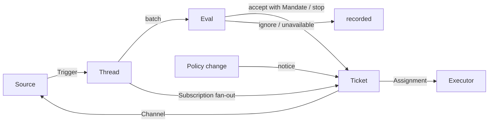

# 001 Domain model

[中文](001-domain.md) · English

This document names the concepts of Xenra-SuperAgent and the rules each one keeps. The code, the tools the agents call, the panel and the other documents use these terms and no others. Following [000 Philosophy](000-philosophy.en.md), the model holds only concepts the work needs; a business need becomes an attribute of one of them or prompt text.

The domain itself knows nothing of GitHub or Feishu: a Source translates the outer vocabulary into Triggers, the Executor translates a Mandate into one piece of work in one directory, and a Channel translates the result back out. `src/core` holds only this model and its ports, and imports no Source implementation.

## Flow

Work moves from Trigger to Eval to execution. A Source produces Triggers; a Trigger is first filtered by the Source's listening scope, then fans out as context to the Tickets subscribed to its Threads. A person's message that reached a Ticket this way stays with that Ticket; every other Trigger enters Eval, which decides whether it asks for new work. When Eval accepts, it creates a Ticket with a Mandate; an Assignment hands the Ticket to the Executor, and results go back to the Source through a Channel.

## Concepts

Source, Trigger, Thread, Eval, Mandate and Subscription form the core domain; the rest supports them.

| Concept | Definition | Rules it keeps | Why it exists |
| --- | --- | --- | --- |
| Source | A stream of events. A Source kind is a reusable implementation; a Source instance is one configuration of a kind: whether it runs and what it listens to | Holds its read position and its own bot identity. Defines what counts as an event, including conditions that only hold over time. Drops the bot's own messages and Triggers outside what it listens to before they enter the domain, recording why. Translates each Trigger into the Threads it belongs to and the Channel addresses to reply on | A restart must not replay events, and the domain need not know the outer system's vocabulary |
| Trigger | One immutable event: id, Source, the Threads it belongs to, its actor, whether a person wrote it, whether it addresses the agent (`mention` or `direct`), a timestamp, its text, and possibly a Channel address and a link, plus the Source's own metadata | Belongs to one or more Threads, the first of which is the primary Thread hosting its Eval. Accepting a Trigger twice creates one Ticket: accepting one that already started a Ticket returns that Ticket | The unit of audit and of idempotence |
| Thread | Triggers in time order; the Source defines which Triggers form one Thread. Holds its Subscriptions, its running Eval, its queue of Triggers awaiting Eval, its Decision history, and the display attributes its Source states (a label and facts) | At most one Eval runs on it at a time, and Triggers arriving meanwhile merge into the next batch. It may have several Tickets. Each writer owns the Thread facts it sets, one of which a Source may mark as a problem needing a person | Gives Eval a consistent view and its context |
| Correlation | The relation between Threads that one Trigger belongs to, recorded when a Thread is created | Adds context; never routes | Lets Eval follow related evidence |
| Channel | The write side of a Thread; the Source defines its addresses | A Thread may have several Channels; a Ticket holds the Channels of the messages it was accepted from. Before sending, the Source is asked whether that address can still receive a reply | Acknowledgements, replies, pull requests and resolved reviews are all writes |
| Policy | The versioned assessment rules, and each Source's part: who may originate work through that Source in that Source's own identities, how the list is synchronized, which bots may make candidates, and each receiving scope's admission cells | The Policy version covers the rules, the accept mode and the Source parts. A change that bears on a live Ticket is delivered to its Assignment as an Input, but revokes no Mandate. Identities on different Sources are never mapped to each other | When the rules change, a running Eval must start again under the new version |
| Eval | The judgement on a batch of Triggers in two layers, gate and assessment. Records the batch, the strength, the actor and the basis the gate found, the Policy version it was built from, its start, when its candidate was delivered, and its deadline | Holds no state: the state lives on the Thread. The batch's strongest admissible Trigger decides the Eval's strength, actor and basis, and becomes the origin of the Ticket it accepts. The deadline counts from the candidate's delivery to the main Session, and processing pauses shift it forward | Decides whether new work starts, goes on or stops |
| Gate | The deterministic first layer of Eval: who may originate work, and with what strength | Enforced by code; prompt text cannot change it. Its result carries the strength and the basis, which a later revalidation reads | Authority cannot be rewritten by message content |
| Assessment | The model's judgement during Eval: implementation intent, whether the target is settled, whether a design decision remains open, and a matched-or-not judgement for each enabled rule | Used for proactive candidates only; an explicit request takes the dispatch path instead. Every enabled rule is judged exactly once, and an accept needs at least one matched rule | Separates "this looks like work" from "this is work" |
| Decision | The result of one Eval: accept, stop, ignore or unavailable, with a reason by code, the strength, the matched rules and audit data | Only an accept creates a Ticket. A stop needs an explicit-strength Trigger and is otherwise recorded as ignore, as is a stop of an ended Ticket. A judgement made under a different Policy version than the current one is recorded as unavailable; when it is still its Thread's running Eval, the batch is queued again under the current version at once | Makes every outcome traceable and reviewable |
| Mandate | What an accept grants: strength, scope, the Policy version it relied on, its actor, and the basis on which the gate admitted it | Immutable; wider scope means a new Ticket. A Ticket's end does not end it: only a person's stop withdraws it, and a Policy that no longer holds it revokes it. An ended Ticket is revalidated against the current Policy before it resumes | States why the work may be done, and how far it may go |
| Ticket | A unit of authorized work: a title, the Decision that created it, its Mandate, its Channels, Assignments, Inputs, the Inputs not yet delivered, the Trigger it came from, its execution details, and how it ended | Only Eval creates one. Refers to its Mandate; holds its Channels and Inputs. Goes open → ended, and back to open when a person's message on one of its Threads resumes it, unless a person stopped it. Defines its own state instead of following the Executor's | Owns the execution and its Reports |
| Assignment | The binding of a Ticket to one Executor instance, with its state, start and end, latest Report, the time Inputs last reached it, and when a turn of its worker last ended idle | A Ticket has several over time. Goes pending → running → ended independently of the Ticket. Only its final Report may end the Ticket | The Executor is outside the domain, but who executes must be inside it |
| Input | Context delivered to a Ticket: a fanned-out Trigger, a Policy change, a resume, text, or a note from the main Session | Each Input has one id, so adding it twice is idempotent. While a Ticket waits for a person, automatic Inputs are held back rather than delivered | Later discussion and rule changes reach the Executor without a new Mandate |
| Subscription | A many-to-many relation between Tickets and Threads, held by the Thread | A matching Trigger fans out to every live subscribed Ticket, with no check of who sent it; a person's message that reaches a Ticket this way takes no Eval. A Thread an Executor follows for context reaches its Ticket the same way, but lends it no authority and does not resume it. An ended Ticket keeps its Subscriptions, including that of a pull request that closed or merged: a person's message resumes it under the same Mandate, with no Eval or Decision, while messages from bots and CI do not resume it. A Ticket a person stopped receives nothing. A person can drop every Subscription on a Thread; an Executor can drop only its own Ticket's Subscription to a Thread it finds unrelated, except the Thread its Ticket started on and a Thread a Source made it follow | Later discussion reaches the Executor without anyone mentioning the agent again |
| Report | The state an Assignment reports to its Ticket: progress, waiting, ready, blocked, failed or dropped, with a summary | Written by the Executor. A Report may carry one question for a person (an Attention) and name the person's message it answers. `dropped` ends the Ticket at once; `ready` ends it only once the Threads it follows are done | Tells a person and the main Session where the work stopped |
| Attention | One concrete question on a Ticket waiting for a person, and the Trigger of the message that asked it | Raised by the Executor through a structured field; when it is replaced or cleared, a question still waiting in the outbox is withdrawn | A question must actually reach a person instead of disappearing into a report |
| Disposition | The record of where a Trigger went: a filter reason, an Eval, a Decision, the Tickets it reached, the ones it reached only for context, its hand-backs, and the Tickets that acknowledged it | Records only, and grants nothing; it decides which Ticket's worker judges a person's follow-up | Makes "where did this message go" answerable |

A person is not a domain concept. A Trigger carries its actor's identifier as the Source gives it. An allowed list is a Source's part of the Policy, in that Source's identities. That one person has accounts on several Sources is prompt text that the agents read when they need it.

The Executor, with its Sessions and directories, is outside the domain and connects through Assignments.

Aggregates: a Source holds its read position. A Thread holds its Subscriptions, its running Eval, which runs serially and merges Triggers that arrive meanwhile into the next batch, and its Decision history. A Ticket holds its Assignments, Channels and Inputs, and refers to Decisions by id.

Code decides who judges a follow-up: a person's message that reached a Ticket still able to decide it — including after a person dropped that Thread's Subscription while the Ticket holds the message — goes to that Ticket's worker and takes no Eval; it is queued again only once no Ticket owns it.

## Rejected concepts

| Rejected | Reason |
| --- | --- |
| Principal or Membership as an entity, or mapping identities across Sources | A person is Trigger metadata; an allowed list is a Source's part of the Policy; a cross-Source mapping is prompt text |
| Eval scheduling its own delayed Triggers | A condition that needs waiting is an ordinary Source, so Eval never depends back on Sources |
| Waiting or revoked Eval states | Waiting belongs to Sources; an Eval that runs out of time queues its Triggers again, or ends `unavailable` |
| At most one live Ticket per Thread | One Thread can carry several independent pieces of work; the assessment avoids duplicates from the Ticket list |
| An "append to Ticket" Decision kind | Appending is Subscription fan-out and attachment, and needs no new Decision kind |
| Admission checks on Subscriptions | A Subscription covers the whole Thread; the Mandate separates authorization from context |
| Correlation that routes | Subscriptions route; Correlation only adds context |
| Ticket state that follows the DSH Session | A Ticket can be handed off, resumed, or run by several Executors, so it defines its own state |
| An Executor declaring that a person asked it to stop | Only Eval decides the strength of an end; an Executor can only hand the message back |
| Cancelling running Tickets on a Policy change | A cancelled change leaves half-finished work; the change is recorded and delivered instead |
| Locking all of an Executor Session's tools when it fails or blocks | It would refuse a person working directly in the Session, and the Report after recovery; pausing automatic input is enough |
| Inferring "waiting on a person" from a report's free text | The classification needs structured facts; the Executor asks through a structured field |

## What is reusable

The concepts above and their rules are reusable: `src/core` depends only on a few ports — the Policy, the Assessor, the Executor, the Outbox and the repositories — and on no concrete Source or model. The Source implementations, the Policy contents, the Executor and the Channel implementations belong to a deployment. Each Source keeps its own words internally, such as message, chat or notification, and translates them into Triggers.

| Part | In this repository |
| --- | --- |
| Source | GitHub: notifications to the agent account, discussion on subscribed Issues and pull requests, CI changes, pull requests merged or closed, and, where switched on, every new Issue, pull request and comment in the repository and the default branch's CI. Feishu: live events, history recovery, polling of subscribed topics, image reading |
| Policy | Assessment rules, and each Source's allowed list, its sync, its bot list and its admission table |
| Executor | A DSH Session named `worker-<ticket id>` and an execution directory per Ticket, in an execution environment whose variables the Executor and the Sources register |
| Channel | Feishu topic replies, GitHub comments and review thread replies |
| Assessor | The main Session: a candidate arrives as a card, reads thread context and the repository within limits, then judges |

## Glossary

A reference list of the terms this and the later documents use, with their Chinese names; the later documents explain the terms not introduced above. The panel shows one language at a time, and its (?) button opens this glossary with Chinese and English side by side. The messages agents send to people on GitHub and Feishu use plain language, not these terms.

| Term | 中文 | Meaning |
| --- | --- | --- |
| Agent | 智能体 | The automated team member Xenra-SuperAgent runs, acting on Sources through identities such as a GitHub account and a Feishu bot |
| Main Session | 主 Session | The DSH Session that assesses Triggers, accepts and dispatches Tickets, and replies; `orchestrator` in code and prompts |
| Executor Session | 执行器 Session | The DSH Session an Executor runs for one Ticket; `worker` in code and prompts |
| Source | 来源 | A stream of events: a kind that a plugin provides, plus one instance configuration |
| Trigger | 触发 | One immutable event from a Source |
| Thread | 线程 | Triggers in time order; the unit within which Evals run one at a time |
| Correlation | 关联 | The relation between Threads that share a Trigger; it adds context only |
| Channel | 渠道 | The write side of a Thread |
| Policy | 策略 | The versioned rules for accepting work, and each Source's part of it, such as who may ask for work there |
| Policy version | 策略版本 | The identifier of one combination of rules, Source parts and accept mode; every Mandate records it |
| Eval | 评估 | The process that turns a batch of Triggers into a Decision |
| Gate | 准入 | The deterministic first layer of Eval: who may originate work, and with what strength |
| Assessment | 研判 | The model's judgement during Eval |
| Decision | 决定 | The result of Eval |
| Mandate | 授权 | What an accept grants: strength, scope and the Policy version it relied on |
| Ticket | 工单 | A unit of authorized work |
| Assignment | 派工 | The binding of a Ticket to one Executor instance |
| Subscription | 订阅 | The relation between a Ticket and a Thread |
| Fan-out | 扇出 | Delivering Triggers of a subscribed Thread to a Ticket as context |
| Executor | 执行器 | The port that runs Assignments: one Executor Session and one directory per Ticket |
| Execution environment | 执行环境 | Where Executor Sessions and the prepare command run: variables that the Executor and the Sources register, each with a key, a value and a description |
| Report | 报告 | The state an Assignment reports to its Ticket |
| Attention | 待人工决定 | A question on a Ticket that waits for a person's answer |
| Disposition | 去向 | The record of a Trigger being filtered, evaluated or fanned out |
| Input | 输入 | Context delivered to a Ticket: fanned-out Triggers, Policy changes, resumes and text |
| Scope | 范围 | The work a Mandate allows |
| Strength | 强度 | How strong the basis of a Mandate or an Eval is |

| Group | Values |
| --- | --- |
| Decision | accept 接单 · reopen 续做 (written by earlier versions) · stop 停止 · ignore 忽略 · unavailable 未完成 |
| Strength | explicit 明确 · inferred 推断 |
| Assignment | pending 待启动 · running 执行中 · ended 已结束 |
| Report | progress 进展 · waiting 等待 · ready 就绪 · blocked 受阻 · failed 失败 · dropped 无需处理 |
| Ticket end | completed 完成 · merged 已合并 · closed 已关闭 · dropped 无需处理 · stopped 被人停止 |
