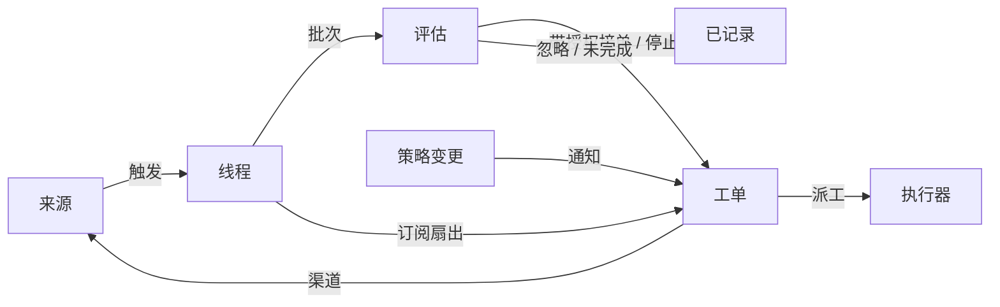

# 001 领域模型

[English](001-domain.en.md) · 中文

本文档命名 Xenra-SuperAgent 的概念，以及每个概念要守的规则。代码、智能体调用的工具、面板和其余文档都用这套词，不用别的说法。按 [000 理念](000-philosophy.md)，模型只保留工作需要的概念；一个业务需求要么成为某个概念的属性，要么成为提示词。

领域本身不认识 GitHub 或飞书：来源把外部的说法翻译成触发，执行器把授权翻译成在某个目录里的一次工作，渠道把结果翻译回外部。`src/core` 只有这套模型与它的端口，不引用任何来源实现。

## 流程

工作从触发流向评估，再流向执行。来源产生触发；触发先按来源的接收范围过滤，再作为上下文扇出到订阅了它所在线程的工单。以这种方式到达工单的人的消息留在该工单，其余每个触发进入评估，由评估判断它是否要求新工作。评估接单时创建一张带授权的工单，派工把工单交给执行器，结果通过渠道回到来源。

## 概念

来源、触发、线程、评估、授权和订阅构成核心领域，其余概念支撑它们。

| 概念 | 定义 | 守的规则 | 存在的理由 |
| --- | --- | --- | --- |
| 来源 | 一条事件流。来源种类是可复用的实现；来源实例是某个种类的一份配置：是否运行、监听什么 | 保存自己的读取位置和自己的机器人身份。定义什么算一次事件，包括只有随时间推移才成立的条件。在机器人自己的消息和监听范围之外的触发进入领域之前就丢弃它们，并记下丢弃的原因。把每个触发翻译成它所属的线程，以及回复要用的渠道地址 | 重启不能重放事件；领域不必知道外部系统的说法 |
| 触发 | 一次不可变的事件：id、来源、所属线程、发起者、是否为人的消息、是否针对智能体（`mention` 或 `direct`）、时间、文本、可能的渠道地址与链接，以及来源自己的元数据 | 属于一个或多个线程，其中第一个是承载评估的主线程。同一个触发被接单两次只产生一张工单：已开过工单的触发再被接单时返回原来那张 | 审计与幂等的单位 |
| 线程 | 按时间排列的触发；由来源定义哪些触发构成一个线程。持有自己的订阅、正在运行的评估、待评估队列和决定历史，以及来源给出的展示属性（标签与事实） | 同一时刻最多只有一个评估在它上面运行；期间到达的触发合并进下一批。它可以有多张工单。来源为展示而给出的线程事实逐项由写入者拥有，其中可标记为需要人处理的问题 | 给评估一致的视图和上下文 |
| 关联 | 同一个触发所属的线程之间的关系，在建线程时记下 | 只增加上下文，从不做路由 | 让评估能沿着相关证据走 |
| 渠道 | 线程的写侧；由来源定义它的地址 | 一个线程可以有多个渠道；一张工单持有它接受时那些消息的渠道。发送前询问来源这个地址是否仍然可收 | 确认、回复、Pull Request 和已解决的 review 都是写操作 |
| 策略 | 带版本的研判规则，以及每个来源的部分：谁能通过该来源发起工作、用该来源自己的身份、名单如何同步、哪些机器人可以产生候选、每个接收范围的准入单元格 | 策略版本覆盖规则、接单模式和来源部分。影响活动工单的变更会作为输入送达它的派工，但不撤销授权。不同来源上的身份从不互相映射 | 规则变化时，正在运行的评估必须按新版本重来 |
| 评估 | 对一批触发的判断，分两层：准入与研判。记录批次、强度、发起者与准入依据、依据的策略版本、开始时间、候选送达时间与截止时间 | 不持有状态：状态在线程上。批次里最强的准入触发决定这次评估的强度、发起者与依据，接单时它成为工单的起点。截止时间从候选送达主 Session 起算，处理暂停期间顺延 | 决定新工作是开始、继续还是停止 |
| 准入 | 评估中确定性的第一层：谁能发起工作，以多强的强度 | 由代码执行，提示词改不了。判定结果带强度与依据，供事后重新校验 | 权限不能被消息内容改写 |
| 研判 | 模型在评估期间作出的判断：实现意图、目标是否已经确定、是否还有未决的设计决定，以及对每条启用规则的命中判断 | 只用于主动候选；明确请求由派工路径直接处理。每条启用的规则恰好判断一次；接单至少需要命中一条规则 | 把"看起来像要做"与"确实要做"分开 |
| 决定 | 一次评估的结果：接单、停止、忽略或未完成，附按代码给出的理由、强度、命中的规则与审计数据 | 只有接单会创建工单。停止需要明确强度的触发，否则记为忽略；对已结束工单的停止同样记为忽略。判断所依据的策略版本与当前不一致时记为未完成；若它仍是该线程正在进行的评估，批次立刻按当前版本重新排队 | 让每个结果可追溯、可复核 |
| 授权 | 接单所赋予的东西：强度、范围、依据的策略版本、发起者，以及它被准入的依据 | 不可变；范围更宽就意味着新工单。工单结束不会结束授权：只有人发出的停止才撤回它，而不再包含它的策略会撤销它。已结束的工单恢复前，要按当前策略重新校验 | 说明工作为何可以做、能做到多远 |
| 工单 | 一份获得授权的工作：标题、创建它的决定、授权、渠道、派工、输入、待送达输入、决定它最初来自哪个触发、执行信息，以及它如何结束 | 只有评估能创建。引用自己的授权；持有自己的渠道和输入。状态由 open 到 ended；人发在它某个线程上的消息使它恢复，除非有人停止过它。它定义自己的状态，而不是跟随执行器 | 持有执行过程和报告 |
| 派工 | 一张工单与一个执行器实例之间的绑定，带状态、起止时间、最新报告、最近送达时间与最近一次空闲时间 | 一张工单随时间可以有多次。状态 pending → running → ended，与工单状态独立。只有它的最后一份报告可以结束工单 | 执行器在领域之外，但"谁在执行"必须在领域之内 |
| 输入 | 送达工单的上下文：扇出的触发、策略变更、恢复、文本或主 Session 的备注 | 每条输入只有一个 id，重复添加是幂等的。工单等待人处理时，自动输入被扣住不送达 | 后续讨论与规则变化无需新授权就能到达执行器 |
| 订阅 | 工单与线程之间的多对多关系，由线程持有 | 匹配的触发扇出到每个活动的已订阅工单，不检查发送者是谁；以这种方式到达工单的人的消息不进入评估。执行器为上下文关注的线程也以同样方式到达它的工单，但不赋予权限、也不会使它恢复。已结束的工单保留自己的订阅，包括已关闭或已合并的 Pull Request 的订阅：人的消息按同一授权使它恢复，不经过评估或决定；机器人和 CI 的消息不会使已结束的工单恢复。被人停止的工单什么都收不到。人可以放弃一个线程上的全部订阅；执行器只能放弃自己工单对某个它认为无关的线程的订阅，但工单起始所在的线程、以及来源让它关注的线程除外 | 后续讨论无需再次 @ 智能体就能到达执行器 |
| 报告 | 派工向其工单汇报的状态：进展、等待、就绪、受阻、失败或无需处理，附摘要 | 由执行器写入；一份报告可以带一个给人的问题（待人工决定），以及它回答的那条人的消息。`dropped` 直接结束工单；`ready` 在它跟随的线程都结束后才结束它 | 让人和主 Session 知道工作停在哪里 |
| 待人工决定 | 工单上等待人回答的一个具体问题，以及提出它的那条人的消息 | 由执行器以结构化字段提出；被替换或清除时，尚未发出的那条提问从消息队列里撤回 | 问题必须真的到达人，而不是消失在报告里 |
| 去向 | 一个触发被过滤、评估或扇出的记录：过滤原因、评估、决定、到达的工单、仅作上下文到达的工单、交回与确认 | 只记录，不授予任何权限；它决定谁来判断人的后续发言 | 让"这条消息去了哪里"可查 |

人不是领域概念。触发携带来源给出的发起者标识。允许名单是策略中某个来源的部分，使用该来源的身份。"同一个人在多个来源上有账号"属于提示词，智能体需要时自行读取。

执行器及其 Session 和目录在领域之外，通过派工接入。

聚合：来源持有读取位置。线程持有自己的订阅、正在运行的评估（串行运行，并把这期间到达的触发合并进下一批）以及决定历史。工单持有自己的派工、渠道和输入，并按 id 引用决定。

后续发言归谁判断由代码决定：一条人的消息如果到达了一张仍能判断它的工单（包括人移除了该线程的订阅、但工单仍持有它的情况），就由那张工单的执行器判断，不进入评估；只有没有任何工单持有它时才重新排队。

## 被否定的概念

| 被否定的概念 | 理由 |
| --- | --- |
| 把主体或成员关系做成实体，或跨来源映射身份 | 人是触发的元数据；允许名单是策略中某个来源的部分；跨来源的映射属于提示词 |
| 让评估自己调度延迟的触发 | 需要等待的条件本身就是一种普通来源，评估因此永远不反向依赖来源 |
| 评估的"等待中"或"已撤销"状态 | 等待属于来源；超时的评估会把它的触发重新排队，或者以 `unavailable` 结束 |
| 每个线程最多一张活动工单 | 一个线程可以承载多件互不相关的工作；研判通过工单列表避免重复 |
| 增加"追加到工单"这个决定 | 追加就是订阅扇出与挂载，不需要新的决定种类 |
| 在订阅上做准入检查 | 订阅覆盖整个线程；授权把"有没有权限"和"是不是上下文"分开 |
| 让关联来做路由 | 订阅负责路由；关联只增加上下文 |
| 让工单状态跟随 DSH Session | 工单可以被移交、恢复，或由多个执行器运行，所以它定义自己的状态 |
| 让执行器声明"有人要求它停止" | 只有评估能决定结束的强度；执行器只能交回 |
| 策略变更时取消正在运行的工单 | 被取消的变更会留下半成品；应该记录并送达这个变更 |
| 执行器 Session 失败或受阻时锁住它的全部工具 | 这会拒绝人直接在该 Session 里工作，也会拒绝恢复后的报告；暂停自动输入就够了 |
| 从报告的自由文本里推断"在等人" | 分类需要结构化事实；执行器通过结构化字段提出 |

## 什么是可复用的

上述概念及其规则是可复用的：`src/core` 只依赖几个端口——策略、研判者、执行器、发件箱与仓库——不依赖任何具体来源或模型。来源实现、策略内容、执行器和渠道实现属于具体部署。每个来源在内部保留自己的说法，例如消息、群或通知，再把它们翻译成触发。

| 部分 | 本仓库中的实现 |
| --- | --- |
| 来源 | GitHub：发给智能体账号的通知、已订阅 Issue 与 Pull Request 的讨论、CI 状态变化、Pull Request 的合并与关闭，以及（开关打开时）仓库里每个新 Issue、新 Pull Request、新评论和默认分支的 CI。飞书：实时事件、历史补收、对已订阅话题的轮询、图片读取 |
| 策略 | 研判规则，以及每个来源的允许名单、它的同步、它的机器人名单和它的准入表 |
| 执行器 | 每张工单一个名为 `worker-<工单 id>` 的 DSH Session 和一个执行目录，位于一个由执行器和来源注册变量的执行环境中 |
| 渠道 | 飞书话题回复、GitHub 评论与 review 线程回复 |
| 研判者 | 主 Session：候选以卡片到达，有界地读取线程上下文与仓库，然后作出判断 |

## 术语表

本表列出本文档及后续文档使用的术语，并给出中文名；上文未介绍的概念由后续文档解释。面板一次只显示一种语言，它的 (?) 按钮以中英两列打开同一份术语表。智能体在 GitHub 和飞书上给人发的消息使用平实语言，不使用这些术语。

| Term | 中文 | 含义 |
| --- | --- | --- |
| Agent | 智能体 | Xenra-SuperAgent 运行的自动团队成员，通过 GitHub 账号、飞书机器人等身份在来源上行动 |
| Main Session | 主 Session | 研判触发、接单派工并回复的 DSH Session；代码和提示词里称 `orchestrator` |
| Executor Session | 执行器 Session | 执行器为一张工单运行的 DSH Session；代码和提示词里称 `worker` |
| Source | 来源 | 一条事件流：由插件提供的某个种类，加上一份实例配置 |
| Trigger | 触发 | 来源上的一次不可变事件 |
| Thread | 线程 | 按时间排列的触发；评估在其中一次只运行一个的单位 |
| Correlation | 关联 | 共享同一个触发的线程之间的关系；只增加上下文 |
| Channel | 渠道 | 线程的写侧 |
| Policy | 策略 | 带版本的接单规则，以及每个来源的部分，例如谁可以在那里请求工作 |
| Policy version | 策略版本 | 规则、来源部分与接单模式某一组合的标识；每份授权都记录它 |
| Eval | 评估 | 把一批触发变成一个决定的过程 |
| Gate | 准入 | 评估中确定性的第一层：谁可以发起工作，以多强的强度 |
| Assessment | 研判 | 模型在评估期间作出的判断 |
| Decision | 决定 | 评估的结果 |
| Mandate | 授权 | 接单所赋予的东西：强度、范围以及它所依据的策略版本 |
| Ticket | 工单 | 一份获得授权的工作 |
| Assignment | 派工 | 一张工单与一个执行器实例的绑定 |
| Subscription | 订阅 | 工单与线程之间的关系 |
| Fan-out | 扇出 | 把已订阅线程的触发作为上下文送达工单 |
| Executor | 执行器 | 运行派工的端口：每张工单一个执行器 Session 和一个目录 |
| Execution environment | 执行环境 | 执行器 Session 与准备命令运行的地方：由执行器和来源注册的变量，每个都有键、值和说明 |
| Report | 报告 | 派工向其工单汇报的状态 |
| Attention | 待人工决定 | 工单上等待人回答的问题 |
| Disposition | 去向 | 一个触发被过滤、评估或扇出的记录 |
| Input | 输入 | 送达工单的上下文：扇出的触发、策略变更、恢复和文本 |
| Scope | 范围 | 授权所允许的工作 |
| Strength | 强度 | 授权或评估的依据有多强 |

| 组 | 取值 |
| --- | --- |
| Decision（决定） | accept 接单 · reopen 续做（早期版本写入） · stop 停止 · ignore 忽略 · unavailable 未完成 |
| Strength（强度） | explicit 明确 · inferred 推断 |
| Assignment（派工） | pending 待启动 · running 执行中 · ended 已结束 |
| Report（报告） | progress 进展 · waiting 等待 · ready 就绪 · blocked 受阻 · failed 失败 · dropped 无需处理 |
| Ticket end（结束方式） | completed 完成 · merged 已合并 · closed 已关闭 · dropped 无需处理 · stopped 被人停止 |
