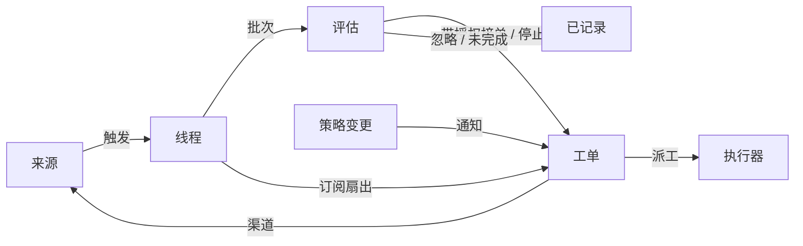

# 001 领域模型

[English](001-domain.en.md) · 中文

本文档命名 Xenra-SuperAgent 的概念，以及每个概念要守的规则。代码、智能体调用的工具、面板和其余文档都用这套词，不用别的说法。按 [000 理念](000-philosophy.md)，模型只保留工作需要的概念，业务需求要么成为某个概念的属性，要么成为提示词。

## 流程

工作从触发流向评估，再流向执行。来源产生触发。触发作为上下文扇出到订阅了它所在线程的工单。以这种方式到达工单的人的消息，留在该工单；其余每个触发都进入评估，由评估判断它是否要求新工作。评估接单时创建一个带授权的工单。派工把工单交给执行器，结果通过渠道回到来源。

## 概念

来源、线程、评估、授权和订阅构成核心领域，其余概念支撑它们。

| 概念 | 定义 | 守的规则 | 存在的理由 |
| --- | --- | --- | --- |
| 来源 | 一条事件流。来源种类是可复用的实现；来源实例是某个种类的一份配置：是否运行、监听什么 | 保存自己的读取位置和自己的机器人身份。定义什么算一次事件，其中包括只有随时间推移才成立的条件。在机器人自己的消息和监听范围之外的触发进入领域之前就丢弃它们。把每个触发翻译成它所属的线程，以及回复要用的渠道地址 | 重启不能重放事件 |
| 触发 | 一次不可变的事件，带来源自己的元数据，例如它的发起者 | 属于一个或多个线程。同一个触发被接单两次，只产生一个工单 | 审计与幂等的单位 |
| 线程 | 按时间排列的触发；由来源定义哪些触发构成一个线程 | 同一时刻最多只有一个评估在它上面运行。它可以有多个工单。它持有自己的订阅、正在运行的评估和决定历史 | 给评估一致的视图和上下文 |
| 关联 | 同一个触发所属的线程之间的关系 | 只增加上下文，从不做路由 | 让评估能沿着相关证据走 |
| 渠道 | 线程的写侧；由来源定义它的地址 | 一个线程可以有多个渠道；一个工单持有一组渠道 | 确认、回复、Pull Request 和已解决的 review 都是写操作 |
| 策略 | 带版本的研判规则，以及每个来源的部分：谁能通过该来源发起工作、用该来源自己的身份、名单如何同步、哪些机器人可以产生候选 | 策略版本覆盖规则、接单模式和来源部分。影响活动工单的变更（例如改动它当初据以接单的规则）会送达它的派工，但不撤销授权。不同来源上的身份从不互相映射 | 规则变化时，正在运行的评估必须作废 |
| 评估 | 对一批触发的判断，分两层：准入与研判 | 输入：触发批次、线程快照、该线程上的所有工单（含已结束的）、当前策略。输出：一个决定。不持有状态 | 决定新工作是开始、继续还是停止 |
| 授权 | 接单所赋予的东西：策略版本、范围、强度、命中的规则、发送者在该来源上的身份，以及来源是如何收到这个触发的 | 不可变；范围更宽就意味着新工单。工单结束不会结束授权：只有人发出的停止才撤回它，而不再包含它的策略会撤销它。已结束的工单恢复前，要按当前策略重新校验 | 说明工作为何可以做、能做到多远 |
| 工单 | 一份获得授权的工作 | 只有评估能创建。引用自己的授权；持有自己的渠道和输入。状态由 open 到 ended；当人发在其某个线程上的消息使它恢复时，回到 open，除非有人停止过它。它定义自己的状态，而不是跟随执行器 | 持有执行过程和报告 |
| 派工 | 一个工单与一个执行器实例之间的绑定 | 一个工单随时间可以有多次。状态 pending → running → ended，与工单状态独立。只有它的最后一份报告可以在执行器一侧结束工单 | 执行器在领域之外，但"谁在执行"必须在领域之内 |
| 订阅 | 工单与线程之间的多对多关系，由线程持有 | 匹配的触发扇出到每个活动的已订阅工单，不检查发送者是谁；以这种方式到达工单的人的消息不进入评估。执行器为上下文而关注的线程也以同样方式到达它的工单，但不赋予权限、也不会使它恢复。已结束的工单保留自己的订阅，包括已关闭或已合并的 Pull Request 的订阅：人的消息按同一授权使它恢复，不经过评估或决定；机器人和 CI 的消息不会到达它，因为执行器恢复时会重新读它的线程。被人停止的工单什么都收不到。只有当消息明确指向某个工单时，主 Session 才把一个线程挂到该工单上。人可以放弃一个线程上的全部订阅；执行器只能放弃自己工单对某个它认为无关的线程的订阅，但它工单起始所在的线程、以及来源让它关注的线程（例如它 Pull Request 所在的线程）除外 | 后续讨论无需再次 @ 智能体就能到达执行器 |

人不是领域概念。触发携带来源给出的发起者标识。允许名单是策略中某个来源的部分，使用该来源的身份。"同一个人在多个来源上有账号"属于提示词，智能体需要时自行读取。

执行器及其 Session 和目录在领域之外，通过派工接入。

聚合：来源持有读取位置。线程持有自己的订阅、正在运行的评估（串行运行，并把这期间到达的触发合并进下一批）以及决定历史。工单持有自己的派工、渠道和输入，并按 id 引用决定。

## 被否定的概念

| 被否定的概念 | 理由 |
| --- | --- |
| 把主体或成员关系做成实体，或跨来源映射身份 | 人是触发的元数据；允许名单是策略中某个来源的部分；跨来源的映射属于提示词 |
| 让评估自己调度延迟的触发 | 需要等待的条件本身就是一种普通来源，评估因此永远不反向依赖来源 |
| 评估的"等待中"或"已撤销"状态 | 等待属于来源；超时的评估会把它的触发重新排队，或者以 `unavailable` 结束 |
| 每个线程最多一个活动工单 | 一个线程可以承载多件互不相关的工作；研判通过工单列表避免重复 |
| 增加"追加到工单"这个决定 | 追加就是订阅扇出，不需要评估 |
| 在订阅上做准入检查 | 订阅覆盖整个线程；授权把"有没有权限"和"是不是上下文"分开 |
| 让关联来做路由 | 订阅负责路由；关联只增加上下文 |
| 让工单状态跟随 DSH Session | 工单可以被移交、恢复，或由多个执行器运行，所以它定义自己的状态 |
| 让执行器声明"有人要求它停止" | 只有评估能决定结束的强度 |
| 策略变更时取消正在运行的工单 | 被取消的变更会留下半成品；应该记录并送达这个变更 |
| 执行器 Session 失败或受阻时锁住它的全部工具 | 这会拒绝人直接在该 Session 里工作，也会拒绝恢复后的报告；暂停自动输入就够了 |
| 从报告的自由文本里推断"在等人" | 分类需要结构化事实；执行器通过结构化字段提出 |

## 什么是可复用的

上述概念及其规则是可复用的。来源实现、策略内容、执行器和渠道实现属于具体部署。每个来源在内部保留自己的说法，例如消息、群或通知，再把它们翻译成触发。

| 部分 | 本仓库中的实现 |
| --- | --- |
| 来源 | 飞书：实时事件、历史补收、对已订阅话题的轮询。GitHub：通知、已订阅的 Issue 和 Pull Request、CI 变化、已合并或已关闭的 Pull Request，以及（开关打开时）仓库里每一个新 Issue、新 Pull Request 和评论，还有默认分支的 CI |
| 策略 | 研判规则，以及每个来源的允许名单、它的同步、它的机器人名单和它的准入表 |
| 执行器 | 每个工单一个 DSH 执行器 Session 和一个目录，位于一个由执行器和来源注册变量的执行环境中 |
| 渠道 | 飞书话题回复、GitHub 评论与 review 线程回复 |

## 术语表

本表列出本文档及后续文档使用的术语，并给出中文名；上文未介绍的概念由后续文档解释。面板一次只显示一种语言，它的 (?) 按钮会以双语打开本表。智能体在 GitHub 和飞书上给人发的消息使用平实语言，不使用这些术语。

| Term | 中文 | 含义 |
| --- | --- | --- |
| Agent | 智能体 | Xenra-SuperAgent 运行的自动团队成员，通过 GitHub 账号、飞书机器人等身份在来源上行动 |
| Main Session | 主 Session | 评估触发、接单派工并回复的 DSH Session；代码和提示词里称 `orchestrator` |
| Executor Session | 执行器 Session | 执行器为一个工单运行的 DSH Session；代码和提示词里称 `worker` |
| Source | 来源 | 一条事件流：由插件提供的某个种类，加上一份实例配置 |
| Trigger | 触发 | 来源上的一次不可变事件 |
| Thread | 线程 | 按时间排列的触发；评估在其中一次只运行一个的单位 |
| Correlation | 关联 | 共享同一个触发的线程之间的关系；只增加上下文 |
| Channel | 渠道 | 线程的写侧 |
| Policy | 策略 | 带版本的接单规则，以及每个来源的部分，例如谁可以在那里请求工作 |
| Policy version | 策略版本 | 规则、来源部分与接单模式某一组合的标识；每个授权都记录它 |
| Eval | 评估 | 把一批触发变成一个决定的过程 |
| Gate | 准入 | 评估中确定性的第一层：谁可以发起工作，以多强的强度 |
| Assessment | 研判 | 模型在评估期间作出的判断 |
| Decision | 决定 | 评估的结果 |
| Mandate | 授权 | 接单所赋予的东西：强度、范围以及它所依据的策略版本 |
| Ticket | 工单 | 一份获得授权的工作 |
| Assignment | 派工 | 一个工单与一个执行器实例的绑定 |
| Subscription | 订阅 | 工单与线程之间的关系 |
| Fan-out | 扇出 | 把已订阅线程的触发作为上下文送达工单 |
| Executor | 执行器 | 运行派工的端口：每个工单一个执行器 Session 和一个目录 |
| Execution environment | 执行环境 | 执行器 Session 与 prepare 命令运行的地方：由执行器和来源注册的变量，每个都有键、值和说明 |
| Report | 报告 | 派工向其工单汇报的状态 |
| Attention | 待人工决定 | 工单上等待人回答的问题 |
| Disposition | 去向 | 一个触发被过滤、评估或扇出的记录 |
| Input | 输入 | 送达工单的上下文：扇出的触发、策略变更、恢复和文本 |
| Scope | 范围 | 授权所允许的工作 |
| Strength | 强度 | 授权或评估的依据有多强 |

| 组 | 取值 |
| --- | --- |
| Decision（决定） | accept 接单 · stop 停止 · ignore 忽略 · unavailable 未完成 |
| Strength（强度） | explicit 明确 · inferred 推断 |
| Assignment（派工） | pending 待启动 · running 执行中 · ended 已结束 |
| Report（报告） | progress 进展 · waiting 等待 · ready 就绪 · blocked 受阻 · failed 失败 · dropped 无需处理 |
