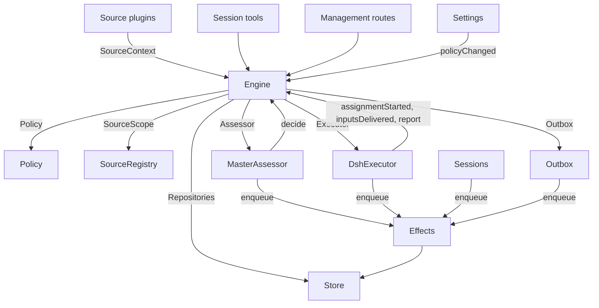

# 007 架构

[English](007-architecture.en.md) · 中文

这是面向实现者的开发指南。它把 [001 领域模型](001-domain.md) 到 [006 部署](006-deployment.md) 里的概念对应到类、接口和文件。先读运行时与 Engine，再把模块表和测试表当作代码索引。

## 核心类与胶水

核心类用小组口守住领域概念和外部边界。胶水把工具参数、HTTP 请求、来源载荷和 DeepSeek Harness 事件翻译成对这些类的调用，再把结果翻译成卡片、视图和消息。

`Runtime`（`src/app/runtime.ts`）构造应用、提供依赖，并拥有启动与关闭。`Engine` 构造自己的内部部件。执行器和研判器要回调 Engine，所以 Runtime 交给它们的是 getter，而不是要求按某种循环顺序构造。

### Runtime

`Runtime` 是组合根，其中不含领域规则。它的构造函数锁住状态目录、打开 Store，并逐个构造组件。构造失败时，它关闭 Store 并释放锁。

启动时注册管理路由并执行 Setup。Setup 完成后，它安装 Session 与执行器钩子、确保主 Session 存在、启动策略同步、恢复被中断的派工，并启动巡检与副作用。`ready` 标记启动完成。

关闭时取消轮次，等待巡检、副作用和智能体，恢复进程环境，关闭 Store 并释放锁。来源插件通过窄接口 `SourceHost` 把 Runtime 注为 `orchestrator` 服务。

| 部件 | 模块 | 做什么 |
| --- | --- | --- |
| Setup | `src/app/setup.ts` | 按执行器 shell 的调用方式探测 CLI，解析出仓库和账号，写入并应用执行器的环境与命令包装脚本，并保留 setup 问题；设置页通过它检查变更后的账号，也通过它重启，而重启会再跑一次 setup |
| Passes | `src/app/passes.ts` | 一次只跑一次巡检，每两秒一次，命令请求时也跑：先到期的副作用，再 `Engine.evaluateDue`；来源的触发经由它到达 Engine |
| Outbox | `src/app/outbox.ts` | Engine 的 `Outbox` 端口，也是回执的唯一写入者：`send` 在一个事务里保存消息的回执并排队它的 `reply` 副作用，该副作用的处理函数通过 `SourceRegistry.send` 发出；来源关闭期间消息等待，会话已不存在或无人监听时消息被丢弃 |
| 通知 | `src/app/notices.ts` | 把领域事件和执行器活动转成主 Session 的消息。`eventNotice` 处理领域通知；`reportRelay` 立即转发问题，把普通进展留在它的工单上，并转达其余报告；`followupRelay` 点名拥有人工后续的工单。一轮进行中到达的转达，通过 DeepSeek Harness 的收件箱在该轮的下一步一起送达 |

### Engine

`Engine`（`src/core/engine.ts`）是触发、线程、决定、工单和派工的唯一写入者。它从 `src/core/ports.ts` 接收这些端口：`Repositories`、一个取当前策略的函数、`SourceScope`、`Assessor`、`Executor` 和 `Outbox`。可选依赖是 `prepareTicket`、`now` 和 `emit`。

Engine 的所有方法都是同步的。每个命令在一个事务里改动它自己的聚合。`evaluateDue` 为它改动的每个评估或工单各用一个事务。端口在事务内排队外部工作，适配器在提交后执行。无效请求抛 `UserError`。

Engine 只暴露一个入口，并委派给五个内部部件。它持有每个命令的事务。跨部件的命令（例如 `attach`、`evaluateDue` 和 `policyChanged`）按顺序调用各部件。

每个部件都继承 `EnginePart`（`src/core/part.ts`），它提供选项和共享的读取。部件之间的依赖只有一个方向：

| 部件 | 职责 | 依赖 |
| --- | --- | --- |
| `Intake` | 来源的触发：连同它的去向保存一次，记录在它的线程及其关联上，扇出到订阅的工单，并且——除非它是到达某个工单的人的消息——在它的主线程上排队等待评估 | 工单 |
| `Evals` | 线程的评估：批量、准入门槛的强度、行为者与依据连同给出它们的触发（`primary`）、从候选送达算起的截止时间及其因暂停而顺延、过期评估的重新排队、候选、重放与交回、策略变更时的重新排队，以及每个评估最终得到的决定：接单、停止、忽略或未完成 | 工单 |
| `Tickets` | 工单生命周期：从一次接单创建（连同授权、订阅和第一次派工）、它跟随的线程及其关闭（`followsDone`）、挂上的线程与为上下文而跟随的线程、输入与备注、恢复以及恢复会拒绝的消息、重试、重启、停止与结束、它放弃的订阅，以及把策略变更通知到受影响的工单 | 回复 |
| `Assignments` | 执行器及其执行器报告的内容：派工开始、输入到达或未到达、重启中断了派工，以及执行器的报告和其中向人提出的问题 | 工单、回复 |
| `Replies` | 通过 `Outbox` 的渠道写入：确认、答复、结果和待人工决定消息，各按允许它的那条规则 | 无 |

命令用祈使句命名，例如 `stopTicket`；适配器上报的事实用以过去时命名的名字，例如 `assignmentStarted`。查询 `candidate` 用名词。

调用者只拿到自己角色的 `Pick`：`EngineForSources`、`EngineForMainSession`、`EngineForPeople`、`EngineForSettings` 或 `EngineForExecutor`。

| 角色 | 方法 | 作用 |
| --- | --- | --- |
| 来源 | `receive(trigger)` | 只保存一次触发，并回答 `stored`、`duplicate`，或在没有来源接收时回答 `filtered`；把它扇出到订阅了它所在线程的工单——人的消息会立即恢复已结束的工单，除非处理处于暂停；并在它的主线程上排队等待评估，除非它是到达某个工单的人的消息，那种情况仍归该工单 |
| 来源 | `bindThread(ticketId, thread, own)` | 让一个开放工单跟随来源的某个线程，例如 Pull Request 的线程；若该线程由这个工单打开，`own` 为真；被再次绑定的已关闭线程重新开放。结束工单的是线程的关闭，而不是 `ready` 报告 |
| 来源 | `threadClosed(thread, outcome, at)` | 一个线程已关闭：跟随它的每个开放工单记录这次关闭，并在它对自己跟随的线程处理完毕（`followsDone`）后结束——它打开的线程都不再开放，或者当它没打开任何线程时，它跟随的每个线程都已关闭。它按这些关闭中最晚的那次结束为 `merged` 或 `closed`，除非关闭之后恢复的工作尚未报告 `ready`，或它的执行器在它最新一份非 `progress` 报告之后、或它最后一轮结束之后，通过确认或回答的方式承担了它自行判断的人的消息，此时会等到那份工作结束；随后一份 `dropped` 报告按那次关闭的结果结束它 |
| 主 Session | `candidate(triggerId)` | 持有某个触发的评估，按研判器看到的样子 |
| 主 Session | `candidateDelivered(evalId)` | 评估的候选已到达主 Session：它的截止时间从现在算起 |
| 主 Session | `decide(triggerId, outcome)` | 记录评估决定，或为明确的请求记录一次直接决定。接单会原子地创建工单、授权、派工、订阅和确认。从卡片上忽略的推断候选先记录 `ignoredFromCard`，再记录给出的理由。`followupOwners` 仍拥有人工后续时，只允许停止 |
| 主 Session | `attach(ticketId, triggerId, note?)` | 把触发路由到它指向的工单，该工单的执行器随后把它当作后续来决定，并结束持有它的评估，该评估的其他触发等待新的评估；已结束的工单在它的授权下立即恢复，除非处理处于暂停。执行器仍在判断的后续会被拒绝，路由回交出它的那个工单的后续同样被拒绝 |
| 主 Session | `requestStatus(ticketId)` | 向等待中的执行器 Session 询问状态，并回答是否问过 |
| 主 Session | `note(ticketId, text)` | 把别处工作中的事实作为文本输入交给工单的执行器，它不授予任何权限 |
| 主 Session、执行器 | `reply(request)` | 按用途指定的渠道排队一条消息：`acknowledgement`、`answer`、`result` 或 `attention` |
| 人 | `stopTicket(ticketId, reason?)` | 人发出的停止，它会撤回授权 |
| 人 | `retryTicket(ticketId)` | 结束一个在 `failed` 或 `blocked` 报告之后等待人的工单的停滞派工，或结束输入送达失败（`canRetry`）的那种派工，并开始新的派工 |
| 人 | `reevaluate(triggerId)` | 把已保存的触发排队等待新的评估 |
| 人 | `unsubscribe(thread)` | 放弃某个线程上的全部订阅，跟随它的工单不再跟随它；每个工单仍继续判断它在那里收到的后续 |
| 人 | `dismiss(decisionId)` | 关闭 `unavailable` 决定所显示的问题，该决定会记录这次关闭 |
| 执行器 | `assignmentStarted(ticketId, assignmentId)` | 派工开始运行；它等待中的输入随之发出 |
| 执行器 | `inputsDelivered(ticketId, assignmentId, inputIds)` | 输入到达派工的执行器 Session，在那里各自等待某一步取用它 |
| 执行器 | `inputsRead(ticketId, inputIds)` | 执行器 Session 把携带这些输入的消息纳入历史（一条 `user/message` Session 事件），模型由此得到它们；此前认领过它们、但被取消或失败的那一步不算。每份输入在随后有一份报告或一轮结束之后算已读，重启之后也如此，它的工单结束也不放过它；在读取记录之前送达的输入，只要其送达之后有一份报告或一轮结束，就算已读 |
| 执行器 | `turnEnded(ticketId, assignmentId)` | 执行器 Session 的一轮结束，报告之后也一样，条件是后台没有为它运行的工作，也没有在移交给人。此前某一步取用的，它已经读过（`inputsRead`） |
| 执行器 | `deliveryFailed(ticketId, assignmentId, error)` | 输入送达失败；工单会显示这一点，直到某次送达成功、开始新的派工或工单结束 |
| 执行器 | `report(ticketId, report)` | 记录一份报告和其中向人提出的问题；`dropped` 结束工单，`ready` 结束不跟随任何线程的工单，并按线程结束的方式结束已处理完所跟随线程的工单 |
| 执行器 | `markUnrelated(ticketId, thread, reason)` | 只放弃该工单对它认为无关的某个已挂上线程的订阅，并连同理由交回工单在该线程上判断的后续 |
| 执行器 | `followForContext(ticketId, thread)` | 让开放工单为上下文订阅一个相关线程：线程的消息到达工单，但不给它后续强度，也不恢复它 |
| 执行器 | `handback(ticketId, triggerId, reason)` | 记录工单交回一个到达它的触发以及其候选携带的理由，并在没有其他工单判断它时（如果本工单判断过）把它排队等待新的评估；返回是否排了队。一个工单对每个触发只交回一次，并保留它的订阅 |
| 执行器 | `assignmentInterrupted(ticketId, assignmentId)` | 宿主停止时正在运行的派工：中途被打断的派工，或在最新一份报告之后收到输入的派工，带一份恢复说明和其执行器 Session 未取用的已送达输入重新开始，与重试相同；此后已经报告过的派工保留它的 Session。DshExecutor 在启动时（`resume`）逐个上报，工单最旧者先，并对等待中的启动再排一次队 |
| Passes | `evaluateDue()` | 除非处理处于暂停：为排队触发仍在等待的线程启动评估，每个线程一个，把期间排队的触发作为一批；把超过截止时间的评估的触发重新排队两次，第三次记为 `unavailable`；并恢复暂停期间收到人的消息的已结束工单，前提是它们的授权仍然成立。候选尚未到达主 Session 的评估不会过期。处理暂停期间没有评估过期，恢复后每个截止时间按暂停时长顺延 |
| 设置 | `policyChanged(from, to, effects)` | 逐个告诉活动工单这次变更以何种方式影响它（`src/policy.ts` 里的 `policyEffects`：它当初据以接单的规则变了或不再适用、它的请求者可能不再能发起工作、或不再接受主动工作），并按新版本重启进行中的评估 |

Engine 把批量、授权、扇出、恢复和待人工决定的规则保持为私有。几个共享谓词让这些规则保持一致：

- `waitsForPerson`（`src/core/model.ts`）：最新派工报告了 `blocked` 或 `failed`，且此后没有人的消息到达。它为真期间，自动输入和失败的启动仍然扣住。
- `followupOwners`：仍对其自己线程上收到的人工后续负责的工单。工单可以处于活动状态，也可以未经人停止而结束并等待恢复。交回该消息即结束这份责任。
- `settled`：某个决定已解决该请求；停止、未完成、路由和拒绝停止的决定不算。
- `ticketStage`（`src/core/stage.ts`）：实现 [003 执行](003-execution.md) 里的阶段表。

工单结束时，未读的后续回到评估，除非另一个工单仍拥有它们，或另一个去向已经解决了它们。已确认、已答复和已交回的消息除外。对没有确认去向的旧记录，由 outbox 的回执提供这一事实。最后一份报告也覆盖派工开始时仍在等待的消息，包括恢复它的那条消息。停止工单的那条消息不会被自动重新评估。

每次变更之后，Engine 从 `src/core/ports.ts` 的 `DomainEvents` 发出一个事件：

`trigger.received`、`eval.started`、`decision.recorded`、`ticket.created`、`ticket.resumed`、`ticket.ended`、`assignment.started`、`assignment.ended`、`thread.subscribed`、`thread.unsubscribed`、`trigger.requeued` 或 `policy.changed`。

Runtime 把 `ticket.ended`、`trigger.requeued` 和 `thread.unsubscribed` 转成通知。送达工单的人的 `trigger.received` 成为一次后续转达。`pullEndNotices` 在工单以 merged 或 closed 结束时发一条会话通知，使用稳定的 id。其余事件目前没有消费者。

### 模型

`src/core/model.ts` 存放领域类型，`src/core/stage.ts` 存放工单阶段。决定把理由记在 `reason` 里，它是 `Reason` 的列表（`src/core/reasons.ts`）：每项是一个 `code` 连同它的 `values`，对批次中的某个触发还有它的 `triggerId`。

核心的编码（例如 `timeout`、`policyChanged`、`routed` 和 `startedTicket`）都在 `REASONS` 里，带有智能体通过 `reasonText` 读取的英文；准入门或来源范围给出自己的编码，例如 `not_a_member`；`said` 承载研判器或人写下的话。面板按 `reason.<code>` 措辞每个编码，来源过滤掉的触发以同样方式记录来源的编码。

工单对每个事实只保存一次。它没有 `ended` 时才算开放，该字段记录何时、由谁、为何、以什么结果结束；它最后说的话是最新一份派工报告（`latestReport`）；它的执行器 Session 以它命名（`src/executor/dsh.ts` 中的 `workerSessionId`）。

它的字段都是带类型的：`origin` 是给了它评估批次强度的那个可准入触发以及该批次本身（`triggerId`、`triggerIds`）；`execution` 是执行器的选择（`name`、`directory` 和 `assignment`）；`delivery` 是最后一次失败的输入送达（`error`、`at`），直到某次送达成功、开始新的派工或工单结束；`follows` 是来源让它跟随的线程，每项是 `{thread, own, closed?}`——工单打开它时 `own` 为真，关闭之后带 `at` 和 `outcome` 的 `closed`。只有工单写入 `follows`；GitHub 来源用 `pullsOf` 和 `pullOf`（`src/sources/github-pull.ts`）读取它的 Pull Request。

携带触发的输入记录是否由人写出，`waitsForPerson` 会读它。线程还在 `context` 里列出只为上下文跟随它的已订阅工单，并在 `expired` 里计数它排队触发中连续过期的评估数；评估记录它的 `primary` 触发和它的候选何时 `delivered`。

触发的去向记录它到达的工单（扇出或挂上）、人的重新排队、每个交回它的工单及其理由，以及每个执行器确认或答复过它的工单。

授权的 `basis`（`MandateBasis`）记录准入门如何接纳它的触发。重新校验读取接收方的 `source`、`scope` 和 `row`，列出的 `sender`、命中的 `rules`，以及 `via`：

| `via` | 准入依据 |
| --- | --- |
| `addressed` | 名单内的发送者 @ 了智能体 |
| `followup` | 消息到达了有工单的线程 |
| `admission` | 准入表的一个格子；`observation` 标记推断的候选 |
| `bot` | 名单内的机器人产生了推断的候选 |

触发和线程的 `meta` 属于来源。核心不解释它们。

### 策略

`src/policy.ts` 定义设置 schema、授权和研判规则。`settingsPolicy(settings, scope)` 每次调用返回一份全新、无状态的 `Policy`：

- `version`、`paused` 和 `evalTimeoutMs` 描述它的当前状态。
- `gate(trigger, thread, tickets)` 返回准入强度和依据。
- `revalidate(mandate)` 检查现有授权是否仍然成立。
- `admitsInferred(rules)` 只在自动模式且匹配规则启用时才允许主动接单。

`assessmentOutcome(assessment, settings, strength)` 把模型的研判转成 Engine 的决定结果。它要求每条启用的规则都有判断、方向已定、有命中的规则，以及有意图的证据。自动模式之外，推断的接单变成一条"本会接单"的记录。

`policyEffects(tickets, old, now, scope)` 找出变更影响哪些开放工单以及如何影响。`Engine.policyChanged` 只通知那些工单。`policyVersion` 对规则、接单模式和来源的策略部分（包括机器人名单）取哈希。

### Store

`Store`（`src/app/store.ts`）拥有一个 SQLite 数据库。Runtime 在打开它之前获取目录锁，防止第二个进程迁移或写入同一份状态。

它的接口按用途分组：

- **领域仓库：** `atomic`，以及 `triggers`、`threads`、`tickets` 和 `decisions`，各自都有 `get`、`save` 和列表查询。有索引的工作集是 `threads.active()`、`tickets.open()`、`tickets.active()` 和 `read.subscribedThreads`。
- **读取查询：** `read` 通过 `threadTriggers`、`triggerStats`、`search` 和 `droppedReplies` 之类的方法服务视图、工具和来源轮询。这些方法从不写入。
- **来源元数据：** `threads.describe` 和 `threads.patchMeta` 更新来源拥有的线程元数据。
- **设置：** `settings`、`saveSettings`、`blockRevision` 和 `settingsHistory`。设置和提示词用带编号的 `Versions`（`src/app/versions.ts`）。
- **Outbox 回执：** `replyStatus` 和 `receipts`，只由 Outbox 写入。回执操作是 `get`、`waiting`、`behind`、`add`、`settle` 和 `withdraw`。`behind` 检查同一工单、同一会话的某条更早消息是否正在等待，且失败次数少于三次。被撤回的消息以 `channelGone` 或 `channelIgnored` 结算。读取查询通过 `failingReplies`、`droppedReplies` 和 `droppedSince` 暴露失败与被丢弃的回复。
- **带类型的键值记录：** `get`、`set`、`delete` 和 `keys`，使用 `KV` 中的条目。

`afterCommit` 只在事务提交后执行动作，回滚后永不执行。Runtime 按保存时的形状读取记录；schema 11 迁移在启动时转换较旧的受支持记录。

### 副作用

`Effects`（`src/app/effects.ts`）是持久化的副作用队列。命令在自己的事务里调用 `enqueue(kind, key, payload)`；只有提交之后才开始执行。

每个 kind/key 对只有一行。对同一个等待中的 key 再次入队会替换它的载荷并让它立即到期，不改变队列顺序。`handle(kind, run, options)` 为每个 kind 注册一个处理函数。它按由旧到新的顺序处理到期行，直到并发上限。

失败按指数退避重试。抛 `Later` 会推迟工作且不计失败，例如没有可用的执行器槽位时。`start` 在 setup 之后开始处理，`drain` 在关闭时停止处理并保留待处理的行，`pending`/`idle` 暴露队列状态。

| 种类 | 处理函数 | 做什么 | 一次几个 | 重试 |
| --- | --- | --- | --- | --- |
| `assessment` | MasterAssessor | 把评估的候选卡片送入主 Session 的一轮，然后告诉 Engine 它已送达，由此启动评估的截止时间 | 4，暂停时为 0 | 2 秒起，翻倍最多到 60 秒 |
| `launch` | DshExecutor | 启动等待中的派工：prepare 命令、执行器 Session、派工消息 | 空闲的执行器槽位数，暂停时为 0 | 模型服务或网络的一次性故障在 5 秒后重跑，翻倍最多到 300 秒，共三次；其他失败以及 prepare 命令失败会使它的工单失败。被暂停或槽位占满扣住的，5 秒后重试 |
| `delivery` | DshExecutor | 按顺序把工单等待中的输入交给它正在运行的派工 | 4，暂停时为 0 | 2 秒起，翻倍最多到 60 秒；等待执行器槽位的那种，2 秒后重试 |
| `relay` | Sessions | 把执行器的报告或问题、或人的后续送入主 Session 的一轮 | 1，按队列顺序 | 2 秒起，翻倍最多到 60 秒 |
| `notice` | Sessions | 不唤醒主 Session 地注入一条通知 | 1，按队列顺序 | 2 秒起，翻倍最多到 60 秒 |
| `reply` | Outbox | 通过来源为某个渠道发一条消息，排在同一工单发往同一会话、且尚未连续失败三次的更早消息之后；撤回该消息会取消它 | 1，暂停时为 0 | 5 秒起，翻倍最多到 300 秒；来源关闭、或排在更早消息之后的那种，5 秒后重试 |

每个种类都以自己的名字下有一条健康条目。某个种类的副作用连续失败三次后，它报出错误；`delivery` 例外，它的失败显示在工单上。转达保持顺序，通知也一样；一条失败会挡住同类的后续项。

### 来源

来源通过 `SourceKind` 扩展宿主，它定义在 `src/sources/kind.ts`。一个种类声明自己的标识、标题、描述、配置 `schema` 和 `fields`、派生出的 `facts`，以及 `health` 条目。可选行为包括 `scope`、`channel`（`allowed`、`send`、`link`）、`threadContext`、`find`、`policy`、`environment` 和 `refreshLabels`。

`SourceRegistry`（`registry.ts`）拥有已注册的种类和已保存的实例，并实现 Engine 的 `SourceScope`。注册会在 `HealthBoard` 上认领健康条目；重复认领和保留的 `sync:` 名字会被拒绝。一个 SourceContext 只通过它所属注册所认领的条目写入，因此注销之后的报告什么也不做。

Registry 的配置方法包括 `kind`、`instances`、`instance`、`validate`、`validatePolicy`、`policyPart`、`channelAllowed`、`declarations`、`environments`、`find` 和 `scope`。`find` 询问每个支持搜索的种类。

通用代码通过 registry 访问来源行为。`send(message, commands)` 调用该种类的渠道，返回 `sent`、`gone`，或在该种类未安装时返回 `waiting`。`link` 解析它的渠道链接。`threadContext` 把种类的读取器与其配置配成一对，种类没有读取器时什么也不返回。无效的已保存配置会禁用该实例。

插件收到 `SourceHost`：registry 和 `context(kind)`。种类本身使用更窄的 `SourceContext`，由 `src/app/source-context.ts` 的 `sourceContextOf` 构造。

该上下文提供部署与命令、setup 就绪状态（`ready`、`configured`、`problem`）、配置、`receive`、`atomic`，以及带类型的 `state`。它还暴露线程读取和元数据写入、工单读取和绑定/关闭命令、触发读取、通过 Outbox 的 `notify`，以及为已声明健康条目提供的 `report`。

### DshExecutor

`DshExecutor`（`src/executor/dsh.ts`）为每个工单提供一个 Session 和一个目录。`start` 和 `deliver` 排队 `launch` 和 `delivery` 副作用。`stop` 通过 `Store.afterCommit` 取消该轮，因此被回滚的结束不会停掉执行器。

`prepare(ticket, outcome)` 提供 Engine 的 `prepareTicket` 钩子：短名、目录和 `ticketExecution` 派工文本。`workerSessionId(ticket.id)` 推导 Session id。

`WorkerSlots` 在启动或唤醒空闲执行器的送达之前预留容量。人的消息可以在 `maxWorkers` 之外多用一格，唤醒优先于启动。`activeCount` 为面板提供负载。

模型服务和网络的一次性故障有三次重试。启动走副作用的退避；失败的轮次在 15、30 和 60 秒后收到继续消息。`inputMessage` 按当前工单状态渲染每份输入，`mandateInstructions` 补上推断工作命中的规则限制。

`install` 订阅 Session 事件；`dispose` 取消订阅。轮次结束通常报告等待，就绪之后或需要人工操作期间例外。错误报告为失败。启动时，`resume` 通过 `assignmentInterrupted` 上报被中断的派工，并把不等待人的待启动派工重新排队，工单最旧者先。

### MasterAssessor

`MasterAssessor`（`src/app/assessment.ts`）让主 Session 研判主动候选。`request` 排队一次研判副作用；`release` 在它的评估结束时丢掉缓存状态。

它的 `context`、`read` 和 `decide` 方法服务于 `orchestrator_eval`、`orchestrator_eval_read` 和 `orchestrator_eval_decide`。它们通过 `SourceRegistry.threadContext` 提供有界的线程上下文、仓库上下文，以及决定提交。没有上下文读取器的种类只提供触发和批次。

`assessmentOutcome` 转换模型对 `Engine.decide` 的答复。评估会按当前策略再次检查推断的接单。

### 设置

`Settings`（`src/app/settings.ts`）读写带修订号的设置块。`current` 和 `view` 读取它们；`save(block, value, revision, origin)` 校验一次保存；`pause(paused, origin)` 改动独立的 `paused` 设置。

每次保存都声明它的来源：`panel`、`tool` 或 `sync`。只有 `panel` 能改动执行环境或 `SETUP_FIELDS`（`src/deployment.ts`）中列出的字段。

策略版本变化时，它计算 `policyEffects`、记录通知了哪些工单，并调用 `Engine.policyChanged`。`syncable` 和 `sync(id)` 刷新来源的策略部分。`refreshLabels(id)` 刷新显示名。

### 提示词

`Prompts`（`src/app/prompts.ts`）把配置保存为 `Versions`。`current`、`version` 和 `history` 读取它们；`validate`、`preview` 和 `save(value, baseRevision, source)` 校验并保存它们。`compose` 和 `skills` 构造 Session 文本。

`builtInParts` 列出覆盖键、角色、默认文本和必需的模板占位符。每个覆盖保存团队的 `text` 和一个 `base`：它原本默认值的 `builtInBase` 键。保存会把这个默认值保留在 `KV.prompts.builtIn` 下。`defaultChanged` 随后报出变更的默认值、它们可得的旧文本，以及移除的部件。

校验从已保存的覆盖继承省略的 base，丢掉已保存数据中已存在的移除部件，并拒绝空文本或其他未知键。这样保存工具能把它读到的配置原样写回。`environmentSection` 和 `policySection` 只用自有键替换一次模板值。没有覆盖的配置使用默认值。

### Sessions

`Sessions`（`src/app/sessions.ts`）为两种角色管理 DeepSeek Harness Session。`ensure` 用角色的模型创建 Session。`install` 跟随智能体事件，并为受管 Session 注册提示词、技能和工具。

`prompt` 对每个请求 id 只送达一次。`relay` 和 `notify` 排队由 `relay` 和 `notice` 副作用处理的主 Session 消息。`src/app/notices.ts` 定义它们的内容；`delivery` 检查消息是否到达。

每次模型请求把 Session 绑定到当前的提示词修订号。用过的修订号被持久保存：`promptVersion` 指明生效的那个，`mayRead` 限制执行器能查看哪些版本。注册按智能体各用一个映射记录。

`status` 和 `promptVersion` 服务提示词页面。保存经由 `Prompts.save` 并通知主 Session。`modelRetry` 暴露模型预算的重试状态。

### 胶水

| 胶水 | 翻译什么 |
| --- | --- |
| `src/app/runtime.ts` | 组合根：用它使用的接口构造各部件，注册路由和来源宿主，并启动和停止 xenra-superagent |
| `src/app/notices.ts` | 领域事件和执行器报告，转成主 Session 的通知和转达 |
| `src/app/tools/main.ts`、`src/app/tools/executor.ts` | 主 Session 和执行器 Session 的工具参数，转成核心类的调用，结果转成卡片 |
| `src/app/http.ts`、`src/app/views/`、`src/app/api.ts` | HTTP 请求转成调用，Store 读取转成面板的视图；`api.ts` 为面板标注每条路由的类型 |
| `src/app/resources.ts`、`src/app/links.ts`、`src/app/cards.ts` | 资源名转成读取，来源消息转成链接，记录转成给模型的紧凑卡片 |
| `src/sources/github*.ts`、`src/sources/feishu*.ts`、`src/sources/poll.ts` | GitHub 与飞书的载荷转成触发和线程事实，消息转成 CLI 调用 |
| `src/deployment.ts`、`src/setup.ts`、`src/infra/` | setup 探测与问题、CLI 传输、智能体的进程环境 |

## 依赖规则

- **依赖明确且窄。** 每个类收到一个点名它所使用内容的接口，多数是其他类的 `Pick` 类型：核心类用 `ExecutorHost`、`AssessorHost`、`SessionsHost`、`SettingsHost`、`SetupHost`、`PassesHost` 和 `OutboxHost`，胶水用 `HttpHost`、`MainToolsHost`、`ExecutorToolsHost`、`ResourceHost`、`LinkHost` 和 `SourceContextDeps`，Engine 则是调用它的那个角色的 `Pick`。Runtime 只在这样的接口之后传递自己。来源插件注入 `orchestrator` 服务，它的类型把该服务声明为 `SourceHost`：registry 和 `context(kind)`；其种类的代码只看到自己的 `SourceContext`。
- **谁能 import 谁。** `src/core` 除 Node 的哈希之外不 import 自身之外的东西，也不做 I/O。`src/sources` 不 import `src/app` 的任何东西。面板只 import 宿主侧的类型，以及 `src/admission.ts`、`src/limits.ts`、`src/setup.ts`、`src/navigation.ts`、`src/sources/host.ts`、`src/core/errors.ts`、`src/core/reasons.ts` 的纯值，和 `src/app/api.ts` 的过滤列表。
- **每种状态一个写入者。** 每种状态只有一个写入者，其他部分读取它，或向那个写入者请求。

  | 状态 | 写入者 |
  | --- | --- |
  | 触发、线程、决定、工单、派工 | Engine |
  | 来源的读取位置，以及它留在自己线程上的元数据（`label`、`url`、`facts` 和自己的键） | 该来源，经由 `SourceContext` |
  | 设置及其历史 | Settings |
  | 提示词版本 | Prompts |
  | 副作用行 | Effects |
  | Outbox 回执 | Outbox：Engine 的消息和来源的 `notify` 都走它的 `send`，由它的 `reply` 副作用标记 |
  | 健康条目 | 在 `HealthBoard`（`src/infra/health.ts`）上认领它的那个部件，它拒绝第二次认领：`runtime` 是 Runtime，巡检通过它上报，`evals` 是每轮之后由 Runtime 上报，`models` 是 Sessions，每个副作用种类由 Effects 上报，`worker` 是 DshExecutor，来源种类的条目由 SourceRegistry 为该种类的来源上报，`sync:<id>` 是设置 |

  来源只通过 `SourceContext.tickets.bindThread` 和 `threadClosed` 改动工单，它们调用 Engine。
- **请求与事实。** 请求某事的方用祈使动词加宾语命名，例如 `stopTicket` 或 `bindThread`，并且可能被拒绝；记录适配器做过什么的方法用过去时命名，例如 `assignmentStarted` 或 `deliveryFailed`。每个宿主按自己需要的角色类型收到 Engine。
- **带类型的字段，来源数据放在来源。** 代码读取工单和授权的带类型字段。来源不在工单上保存任何东西：工单跟随来源的哪些线程是工单的 `follows`，来源关于触发或线程保存的东西在它们的 `meta` 里。
- **固定的拒绝。** 人或智能体可以引起的拒绝是来自 `src/core/errors.ts` 中 `USER_ERRORS` 的 `UserError(code, values)`。管理 API 对 `missing` 编码返回 404，其余返回 400，面板按自己的语言措辞每个编码。setup 问题是 `SetupError` 编码（`src/setup.ts`），固定的健康文本是 `HealthCode`（`src/sources/host.ts`），措辞方式相同。
### 特定于来源的依赖

有些通用模块仍然直接引用 GitHub 或飞书：

- Outbox 应用飞书的会话字数上限。
- `src/app/links.ts` 解析飞书消息链接和 `repliedTo`。它和 Runtime 用 `feishuSettings` 读取设置。
- `src/app/resources.ts` 读取 `feishu/` 和 `github/` 的原始记录；`src/app/cards.ts` 用 `pullOf` 生成工单卡片。
- Runtime 为 merged 或 closed 的工单发送 `pullEndNotices`。
- 执行器工具用 `readPull` 和 `claimPull` 绑定上报的 Pull Request，使用 Runtime 暴露的 GitHub 上下文。
- MasterAssessor 用 `readRepositoryPath` 读取仓库文件。
- Sessions 和 Prompts 只为 GitHub 和飞书注册内置技能。迁移会转换它们的 schema 10 记录。
- Setup 只探测 GitHub 和飞书的账号字段（`SETUP_FIELDS`）。只有这些来源通过 `SourceContext.problem` 收到账号 setup 问题。

## 模块

| 路径 | 职责 |
| --- | --- |
| `src/index.ts` | 插件主入口：读取机器设置、启动 Runtime，并把保存来源账号时所用的重启交给它 |
| `src/deployment.ts` | 插件的 `Config` 和 `Machine`；`resolveDeployment` 和 `resolveFeishuBot` 从来源设置里读出仓库和账号，每次 CLI 调用都按执行器 shell 的方式运行；`SETUP_FIELDS` 列出 setup 读取的来源字段。代码不点名任何人、账号或组织 |
| `src/setup.ts` | setup 问题：`SetupError`，带一个编码、修复它的位置，以及日志、主 Session 和面板共用的英文文本 |
| `src/policy.ts` | 策略：按块的设置 schema、策略版本、准入门与授权重新校验 |
| `src/admission.ts` | 准入表的值、每个格子的选项和默认值，与面板共用 |
| `src/limits.ts` | 人设置的值的上限，由设置 schema 校验，并由面板的字段给出 |
| `src/kv.ts` | `KV`：每一族 `kv` 记录及其键、值的类型和所有者，以及 Store 和 `SourceContext.state` 接受的 `Key` 与 `Family` 类型 |
| `src/navigation.ts` | 宿主目录列出某个 DeepSeek Harness Session 之后，从面板打开它 |
| `src/core/model.ts` | 领域类型，其中包括带类型的工单和 `MandateBasis`，以及 `threadKey`、`ticketOutcome`、`reached`、`followupOwners`、`settled`、`waitsForPerson`、`liveTicket`、`runningAssignment`、`latestAssignment` 和 `latestReport` |
| `src/core/ports.ts` | 端口：`Repositories`、`Policy`、`SourceScope`、`Assessor`、`Executor`、`Outbox`，以及领域事件 |
| `src/core/engine.ts` | Engine，核心的入口，以及角色接口 `EngineForSources`、`EngineForMainSession`、`EngineForPeople`、`EngineForSettings` 和 `EngineForExecutor` |
| `src/core/part.ts` | `EnginePart`，Engine 各部分的基类，以及 `EngineOptions` |
| `src/core/intake.ts` | `Intake`：把来源的触发送到它们的工单，并在人的消息没有到达工单时送到评估 |
| `src/core/evals.ts` | `Evals`：线程的评估及其决定 |
| `src/core/tickets.ts` | `Tickets`：工单生命周期、工单跟随的线程、订阅和输入 |
| `src/core/assignments.ts` | `Assignments`：执行器的事实及其执行器的报告 |
| `src/core/replies.ts` | `Replies`：Engine 的渠道写入 |
| `src/core/stage.ts` | `ticketStage` 和 `canRetry`：[003 执行](003-execution.md) 中的工单阶段 |
| `src/core/errors.ts` | `UserError` 和 `USER_ERRORS` |
| `src/core/reasons.ts` | `Reason`、`REASONS` 和 `reasonText`：核心记录某个决定或搁置某个触发的原因，按编码 |
| `src/core/ids.ts` | `key`：由输入推导的 id，相同输入得到相同的 id |
| `src/core/memory.ts` | `MemoryRepositories`：Store 仓库的内存版，保持 Store 的顺序和嵌套回滚，用于领域测试 |
| `src/core/index.ts` | 核心的导出 |
| `src/app/runtime.ts` | Runtime，组合根，连同它的启动与停止 |
| `src/app/setup.ts` | Setup，以及 `setupChanged`：一次保存是否改动了 setup 读取的字段 |
| `src/app/passes.ts` | Passes，巡检调度器 |
| `src/app/outbox.ts` | Outbox：Engine 的 `Outbox` 端口、回执，以及发送它们的 `reply` 副作用 |
| `src/app/notices.ts` | 主 Session 的通知与转达：`eventNotice`、`reportRelay`、`resultRelay` 和 `followupRelay` |
| `src/app/store.ts` | Store，以及 `Receipt`，outbox 的一条消息 |
| `src/app/store-read.ts` | `storeReads`：供视图、工具和来源轮询使用的 Store 读取查询，从不写入 |
| `src/app/migration.ts` | schema 11 迁移：从 schema 10 一步到位，把每条已保存记录写成当前的形状 |
| `src/app/effects.ts` | 副作用 |
| `src/app/versions.ts` | `Versions`：以带编号的快照加一个指向当前快照的指针保存的记录，用于设置和提示词 |
| `src/app/cache.ts` | `TextCache`：在内存中按大小上限保留的文本，最久未用的先丢 |
| `src/app/settings.ts` | 设置 |
| `src/app/settings-history.ts` | `policyHistory`：每个已保存的设置修订号，连同它相对上一版改了什么 |
| `src/app/prompts.ts` | 提示词、`builtInParts`（团队可以覆盖的内置部件），以及 `promptParts`（角色提示词各节的顺序） |
| `src/app/context.ts` | 从 `prompts/` 读取的内置提示词文本，以及 Session 读取的记录条目 |
| `src/app/skill-files.ts` | 打包的文本：`promptFile`，把文件里一句一行的内容连成段落，以及随包发布的技能 |
| `src/app/sessions.ts` | Sessions |
| `src/app/delivery.ts` | `AgentDelivery`：对每个请求 id 只向 DeepSeek Harness 智能体送达一次消息，跨被恢复的 Session 也如此 |
| `src/app/retry-health.ts` | `RetryHealth`：哪些 Session 在等待模型预算重试，供 `models` 健康条目使用 |
| `src/app/role-models.ts` | 解析评估模型和执行器模型，并用角色的模型初始化新的 Session |
| `src/app/assessment.ts` | MasterAssessor、研判 schema，以及 `orchestrator_eval` 回应的窗口 |
| `src/app/execution-environment.ts` | 执行环境：它的变量、工单的取值、目录根，以及提示词各节的各行，由 `src/app/prompts.ts` 填入它的模板 |
| `src/app/source-context.ts` | `sourceContextOf`：每个来源种类的 `SourceContext` |
| `src/app/links.ts` | `sourceLink`（触发消息所在的页面）和 `candidateCard` |
| `src/app/cards.ts` | 给模型的触发、工单、线程和决定的紧凑卡片，工单卡片状态的封闭集合 `TICKET_STATES`，以及 `textPage` |
| `src/app/resources.ts` | `RESOURCES` 和 `readResource`：`orchestrator_read` 按角色读取的内容 |
| `src/app/tools/tool.ts` | `Tool` 类型、`readTool`、两种角色的 `orchestrator_read`，以及 `AcknowledgementSchema` |
| `src/app/tools/main.ts` | 主 Session 的工具 |
| `src/app/tools/executor.ts` | 执行器 Session 的工具 |
| `src/app/http.ts` | `/orchestrator/api` 路由：同源检查、请求上限，以及每种失败一个状态码 |
| `src/app/api.ts` | `Api`：每条路由及其参数、查询、请求体和响应，以及列表的过滤条件；它只 import 类型，所以面板能打包它 |
| `src/app/views/text.ts` | 视图文本的两种形式：`preview`，单行纯文本，以及不含 HTML 的 `markdown`；`plain` 和 `readable` |
| `src/app/views/records.ts` | 视图共用的行：触发、工单、线程、决定和渠道链接，以及 `ownersOf`（一次读取所见的后续所有者） |
| `src/app/views/tickets.ts` | 按阶段分列的工单列表、工单页面、授权依据事实和执行器负载 |
| `src/app/views/threads.ts` | 线程列表、线程时间线、搜索和决定列表 |
| `src/app/views/sources.ts` | 来源状态：每个来源实例的状态、它最近一天的计数，以及它那一天过滤和丢弃的内容 |
| `src/app/views/settings.ts` | 设置页的视图：每个块连同它的修订号、每个来源的设置连同它种类的表单，以及执行环境 |
| `src/app/views/overview.ts` | 总览：需要人的工单、问题、最近一天的流程和执行器负载 |
| `src/executor/dsh.ts` | DshExecutor、`WorkerSlots`、`ticketExecution`、`inputMessage` 和 `mandateInstructions` |
| `src/executor/background.ts` | 执行器在 DeepSeek Harness 中的后台工作，即它的 Session 拥有的 shell 作业（`ctx.jobs`）和它的子智能体（`ctx.subagents`）：`runningJobs`、`untilQuiet`、`killJobs`、`collectJobs`、`stopSubagents`、`stopBackground`、`until`，以及 `cancelled`——那些因停止其子智能体而被取消轮次的执行器 |
| `src/infra/commands.ts` | `Commands`，CLI 传输：`run`；`api` 和 `pages`，限定在已配置的仓库并经过校验；以机器人身份的 `lark`；`git`。`CliError` 携带命令输出所报的编码，例如一个 GitHub HTTP 状态；不打印任何东西的命令以它的结束方式失败，绝不带出它的参数；`validItems` 跳过并计数列表中的畸形条目 |
| `src/infra/environment.ts` | 智能体的进程环境：命令包装脚本、git 配置与凭据助手、`runAsWorker`，以及环境和工单目录的检查 |
| `src/infra/paths.ts` | 包的根目录，打包文件所在的位置 |
| `src/infra/text.ts` | 字数统计与会话消息上限、`fill` 和 `sameName` |
| `src/infra/health.ts` | `HealthBoard`，每个部件的健康条目，各由唯一的写入者认领 |
| `src/sources/kind.ts` | `SourceKind` 协议 |
| `src/sources/registry.ts` | `SourceRegistry` |
| `src/sources/host.ts` | `SourceHost`、`SourceContext`、`Health`、`health` 和固定的健康文本 |
| `src/sources/poll.ts` | GitHub 与飞书轮询共用的部分：`POLL_HORIZON_MS`、`polled`、`cursorAt`，以及 `pollThreads`——它把失败以 `pollError` 留在对应的线程上 |
| `src/sources/github.ts` | GitHub 种类和插件入口，导出为 `./github-watch`：一轮通知轮询、开放工单的 Pull Request 及其 CI，以及已订阅的线程 |
| `src/sources/github-trigger.ts` | GitHub 的评论、review、Issue 正文和 CI 变化作为触发，以及 GitHub 地址 |
| `src/sources/github-pull.ts` | Pull Request 规则：工单跟随哪些 Pull Request（`claimPull`、`observePull`）、它向 Engine 报告的关闭，以及 `pullEndNotices`——工单以 merged 或 closed 结束时的会话通知 |
| `src/sources/github-channel.ts` | GitHub 渠道：评论和 review 线程回复，`sent` 或 `gone` |
| `src/sources/github-read.ts` | CI 快照、仓库读取、`github/` 资源，以及 `githubThreadContext`：按页读取 Issue 或 Pull Request 的会话 |
| `src/sources/feishu.ts` | 飞书种类和插件入口，导出为 `./feishu-watch` |
| `src/sources/feishu-trigger.ts` | 飞书消息作为触发，对实时事件、历史页和话题页用同一套规则 |
| `src/sources/feishu-loops.ts` | 飞书循环：事件消费者、历史恢复、会话名，以及已订阅话题的轮询 |
| `src/sources/feishu-channel.ts` | 飞书渠道：话题回复，`sent` 或 `gone` |
| `src/sources/feishu-read.ts` | 触发消息的 `feishu/` 读取、它的根、父和话题，以及 `feishuThreadContext`——连同图片把它们交给研判 |
| `src/sources/admission-context.ts` | 研判起始的有界窗口：经由触发所属种类读取的线程首页，以及触发周围的消息 |
| `src/sources/feishu-image.ts` | 把飞书消息中的图片读为附件，供研判的 Session 使用 |
| `src/client/index.tsx` | 客户端插件入口：侧边栏条目、主面板，以及 DeepSeek Harness 插件管理器中的页面 |
| `src/client/app.tsx` | 面板：页头、搜索、术语表、标签页和当前路由的页面 |
| `src/client/provider.tsx` | 每个页面从宿主读取的内容：文案、调用、导航、通知、状态轮询，以及 `restart`——xenra-superagent 重启期间用它快速读取状态 |
| `src/client/api.ts` | 管理 API 的调用与轮询，类型由 `src/app/api.ts` 给出，以及评估状态的决定过滤条件 |
| `src/client/route.ts` | 标签页、设置分组、`parseRoute` 读取的带类型路由，以及记住最后打开的设置分组的路由记忆 |
| `src/client/overview.tsx` | 总览 |
| `src/client/source.tsx`、`trigger.tsx`、`eval.tsx`、`execution.tsx` | 每个阶段一个文件：它的状态，以及它拥有的设置 |
| `src/client/thread.tsx`、`ticket.tsx` | 记录页面：带时间线的线程，以及带授权、输入和派工的工单 |
| `src/client/settings.tsx` | 设置标签页：分组导航和屏幕上的分组 |
| `src/client/settings-kit.tsx` | 设置块的构件：各阶段分组共用的设置、`useBlockDraft`、各种字段（其中包括来源种类的字段），以及保存历史 |
| `src/client/prompts.tsx` | 提示词设置：页面持有它读到的视图，编辑器持有草稿，编辑、完整提示词和历史标签页据此渲染；内置部件的编辑器会显示变更的默认值，并保留或放弃覆盖 |
| `src/client/prompt-config.ts` | 提示词配置，按预设各节、团队各节、技能名、内置部件（`part/<key>`，连同 `withOverride`）和提示词视图给出的部件标题组织，以及完整提示词的行级差异，均为纯函数 |
| `src/client/deployment.tsx` | 部署设置，也显示在 DeepSeek Harness 的插件管理器中 |
| `src/client/draft.tsx` | 设置草稿：`draftReducer`、它的各种状态及其与更新的已保存修订号的合并、`saveBarText`（保存栏的那一行），以及保存栏 |
| `src/client/controls.tsx` | DeepSeek Harness 控件的本地副本，遵循它的标记、键盘行为和设计 token，因为本 bundle 不 import `@deepseek-ai/dsh-client-ui-primitives`；它们不读任何上下文 |
| `src/client/widgets.tsx` | 页面共用的小组件，读面板的上下文：小节、页头、加载状态、时间、链接、需确认的操作、setup 检查和 Markdown |
| `src/client/rows.tsx` | 页面共用的行：一个工单、一个线程和一个决定，线程的标签，以及连续自动消息的折叠 |
| `src/client/markdown.ts` | 报告与问题所用的 Markdown 子集，以及消息中的裸地址，作为块和内联部分 |
| `src/client/text.ts` | 按键取文案，以及领域取值、原因、发送者和时间的措辞 |
| `src/client/marks.ts` | 视图所归类状态的标记：工单或线程的阶段、来源的状态、决定的结果，各为一个圆点、一个图标、一种色调和一个标签 |
| `src/client/locales.ts` | 两种语言的全部文案，以及 [001 领域模型](001-domain.md) 的术语表 |
| `src/client/client.css`、`css.d.ts` | 面板的样式表，以文本形式加载 |

`src/sources/github.ts` 和 `src/sources/feishu.ts` 也是两个来源插件的入口，由 `tsdown.config.ts` 构建，并在 `package.json` 中导出为 `./github-watch` 和 `./feishu-watch`。bundle 的 `cordis.patch.yml` 插入这三个插件，飞书处于停用状态。

## 测试

| 测试 | 覆盖 |
| --- | --- |
| `tests/core-engine.spec.ts` | 内存仓库上的领域规则：接收、评估、扇出、恢复与停止、被中断的派工、暂停、策略变更、报告与结果、挂上、回复、失败的送达和被关闭的问题 |
| `tests/stage.spec.ts` | 工单阶段，逐行 |
| `tests/policy.spec.ts` | 来源范围、准入门、准入表、授权重新校验、策略版本、设置迁移和研判结果 |
| `tests/registry.spec.ts` | `SourceRegistry`：实例、校验、策略部分、渠道和线程上下文 |
| `tests/sources.spec.ts` | `SourceContext` 上的飞书与 GitHub 来源：翻译、轮询与读取位置、Pull Request 规则、健康 |
| `tests/commands.spec.ts` | 以部署的账号调用 CLI、渠道的回答，以及限定在仓库上的 GitHub 调用 |
| `tests/feishu-read.spec.ts`、`tests/github-read.spec.ts` | 飞书与 GitHub 的读取 |
| `tests/admission-context.spec.ts`、`tests/feishu-image.spec.ts` | 研判的线程窗口，以及飞书图片读取 |
| `tests/assessment.spec.ts` | MasterAssessor 为每个评估保存什么，以及何时放手 |
| `tests/background.spec.ts` | 等待执行器的 shell 作业和子智能体：一次唤醒它的结束，以及一个停下的宿主 |
| `tests/bundle-patch.spec.ts` | bundle 的补丁，按 DeepSeek Harness 读取它的方式，以及它定义的执行器 Session 智能体预置 |
| `tests/effects.spec.ts` | 副作用队列：合并、上限、带退避的重试、健康和关闭 |
| `tests/passes.spec.ts` | Passes：一次只跑一次巡检，一次巡检进行中被请求的在其后合为一次运行，以及失败的一次巡检报告出的运行时健康 |
| `tests/outbox.spec.ts` | 运行中的 Runtime 上的 Outbox：处理暂停或来源未安装时消息等待 |
| `tests/cache.spec.ts` | `TextCache` |
| `tests/queue.spec.ts` | Runtime 经由副作用队列的工作，以及更早版本存储了什么 |
| `tests/followups.spec.ts` | 工单线程上的人的后续：发给主 Session 的通知、处理它的工具、一次涌入的代价；执行器随后的交回与上下文跟随，以及主 Session 的备注 |
| `tests/health.spec.ts` | 每个部件一个健康条目，各由它自己的下一次成功清除 |
| `tests/delivery.spec.ts` | `AgentDelivery` |
| `tests/retry-health.spec.ts`、`tests/role-models.spec.ts` | 模型预算重试，以及两种角色的模型 |
| `tests/runtime.spec.ts` | 在模拟的 DeepSeek Harness 宿主上的整个应用，经由工具和 HTTP |
| `tests/tools.spec.ts` | Session 的工具：`orchestrator_read` 为每个角色读取什么，以及其他主 Session 工具的形状和校验 |
| `tests/runtime-concurrency.spec.ts` | 重叠的工作：一轮进行中到达的触发、在送达和启动期间变化的工单 |
| `tests/http.spec.ts` | 同源与 loopback 检查、每类失败的状态码、请求体上限、路径参数和查询 |
| `tests/settings.spec.ts` | 与模型或账号检查竞争的设置保存、一次保存跑过的策略同步，以及暂停、同步和块的拒绝 |
| `tests/views.spec.ts` | 管理视图从 Store 推导出的内容，例如被丢弃的消息属于哪个线程 |
| `tests/timeline.spec.ts` | 线程的分页，以及触发按时间再按 id 的相邻关系，每个收到的触发的时间都用同一种形式 |
| `tests/migration.spec.ts` | schema 11 迁移：每条已保存记录处于当前的形状，以及更旧 schema 的拒绝 |
| `tests/store.spec.ts` | 仓库及其工作集，在 SQLite 中与在内存中一致，kv 区域，其中 `KV` 的每个键只在 `src/kv.ts` 和迁移中拼写，以及设置历史与查询 |
| `tests/prompts.spec.ts` | 提示词校验、组装和版本 |
| `tests/cards.spec.ts` | 内置文本必须写明的规则，逐文件 |
| `tests/model-surface.spec.ts` | 模型读到的一切：工具、提示词、技能和输入，按工具 schema、执行环境和术语表核对，每个角色有体积上限 |
| `tests/deployment.spec.ts`、`tests/environment.spec.ts`、`tests/index.spec.ts` | 插件配置与 setup、智能体的进程环境、插件入口 |
| `tests/service-script.spec.ts` | `scripts/xenra-superagent` 对着假的 `ps`、`tmux` 和 `dsh` |
| `tests/client.spec.tsx`、`tests/navigation.spec.ts`、`tests/controls.spec.tsx` | 客户端插件的注册与轮询、Session 导航与路由记忆、本地控件，以及面板的 import（没有环） |
| `tests/panel-overview.spec.tsx`、`panel-source.spec.tsx`、`panel-trigger.spec.tsx`、`panel-eval.spec.tsx`、`panel-execution.spec.tsx` | 面板的每个页面，对着按路由作答的假管理 API |
| `tests/panel-settings.spec.tsx`、`panel-prompts.spec.tsx`、`panel-deployment.spec.tsx`、`panel-panel.spec.tsx` | 设置分组、草稿与历史、提示词、部署页面，以及面板的搜索、术语表和路由记忆 |
| `tests/draft.spec.ts`、`tests/prompt-config.spec.ts`、`tests/markdown.spec.ts`、`tests/marks.spec.ts` | 草稿状态、合并与保存栏的那一行；按节给出的提示词配置与行级差异；Markdown 子集及其链接；视图归类的每个状态的标记 |
| `tests/locales.spec.ts`、`tests/styles.spec.ts` | 两种语言的文案、样式表 |
| `tests/class-docs.spec.ts` | `src` 中每个类前面都有 JSDoc 块 |
| `tests/docs.spec.ts` | 编号文档只链接更早的编号文档、每个本地链接都能解析、没有文档含合并冲突标记，以及本文档的表格列出每个模块和每个测试 |

`tests/fixtures/` 存放几个测试共用的东西：`host.ts`，一个模拟的 DeepSeek Harness 宿主；`panel-server.ts` 和 `panel.tsx`，假管理 API 和包住页面的面板；`deployment.ts`，一份解析好的部署；`git.ts`，测试启动的每次 git 的环境，它不点名任何仓库；以及 `async.ts`。

## 持久化

一个 SQLite 文件，`<stateDir>/orchestrator.sqlite`，只有 Store 打开它。

| 表 | 存放 | 写入者 |
| --- | --- | --- |
| `trigger` | 每个触发，以及它的时间 `at`，采用 `Date#toISOString` 给出的那一种形式，在 Engine 接收它时设定，因此时间可以按文本比较 | Engine |
| `disposition` | 每个触发去了哪里：`filtered` 连同来源的原因编码、它的评估与决定、它到达的工单（扇出或挂上）、它是否被重新排队、交回它的工单及其理由，以及执行器确认或答复过它的工单 | Engine |
| `trigger_thread` | 每个触发位于哪些线程，连同它的时间以及是否由人写出，因此读取线程的触发无需扫描全部触发，顺序是先时间再 id：线程时间线的一页从 `<at>|<id>` 游标继续，时间相同的触发不会被跳过 | Store，随每个触发 |
| `thread` | 线程：订阅、为上下文跟随它的工单、排队的触发、进行中的评估、它的过期计数和 `meta`；生成列 `active`，在有触发排队或评估运行期间置位，以及 `subscribed`，在有工单订阅它时为其来源 | Engine；来源写 `meta` |
| `ticket` | 工单及其授权、来源、执行、派工、渠道、输入和它跟随的线程；生成列 `open`，在它尚未结束期间置位，以及 `active`，在有输入未送达或最新派工处于 pending 或 running 期间置位 | Engine |
| `decision` | 决定，按线程 | Engine |
| `effect` | 副作用队列：按种类和 key，载荷、它的顺序、失败的尝试及最后一次错误，以及它何时到期 | Effects；schema 11 迁移会为更早版本保留给主 Session 的内容入队 |
| `outbox` | 每个渠道消息的回执，按 id，连同它所属的工单及其 `status`（`pending`、`sent` 或 `dropped`），保留它是为了一个 id 永不入队两次；对被丢弃的消息，还有何时为何，以生成列 `dropped`、它的时间和一个原因编码表示。等待中的消息有一个 `reply` 副作用，它持有尝试次数 | Outbox |
| `kv` | 其余每条记录，按键 | 点明它的那个部件 |

生成列由其行的 JSON 计算得出，不在它的集合内时为空，每个生成列都在自己的集合上有索引，因此一轮只读活动的工作。早于某个列的数据库会在 Store 打开它时得到该列。

`KV`（`src/kv.ts`）定义每条键值记录的所有者、键和类型。所有读写者都使用这些条目；只有迁移代码才点名更旧的键。

| 记录 | 键或内容 |
| --- | --- |
| schema | 当前 schema 版本 |
| 设置版本 | `settings-revision`、`settings-version:<n>`、`settings-block-revision:<block>`；快照包含来源、策略版本和受影响的工单 |
| 提示词版本 | `prompt-revision`、`prompt-version:<n>` |
| 主 Session | `master-id` |
| Session 提示词历史 | `session-prompts:<session id>` |
| 来源状态 | 读取位置，例如 `github-cursor:<number>`、PR CI 指纹和已见的飞书话题消息；键以种类名或 `thread-` 加线程键开头 |
| 显示名 | `source-labels:<source id>` |

关闭状态保存在其决定上。输入文本在读取时由工单渲染，所以两者都不需要单独的键值记录。

读取缓存使用有界的内存 `TextCache` 实例，重启即丢。翻页读取某个来源原始记录或提示词预览的 Session，在重启之后必须重读偏移 0。接收之后解析的飞书链接以同样方式缓存；基于链接的搜索只有在当前进程生命周期内读取过该链接之后才能找到它们。

目前没有任何东西删除旧记录，所以这些会无界增长：`trigger`、`disposition` 和 `decision` 行；已结束的工单及其线程；outbox 的回执；以及 `kv` 中每个已保存的设置修订号和提示词版本、每个 Session 工作过的提示词修订号，以及来源按线程和按 Issue 或 Pull Request 保存的记录。

`SCHEMA_VERSION` 只增不减。更新版本的数据库拒绝启动；`src/app/migration.ts` 在启动时把预发布版 schema 10 的数据库升级一次，更旧的则拒绝。

## 面向模型的接口

### 主 Session 的工具

主 Session 有 14 个应用工具：

| 用途 | 工具 |
| --- | --- |
| 读取与路由 | `orchestrator_read`、`orchestrator_route` |
| 管理工单 | `orchestrator_ticket_retry`、`orchestrator_ticket_request_status`、`orchestrator_ticket_note` |
| 重新评估 | `orchestrator_trigger_requeue` |
| 研判主动工作 | `orchestrator_eval`、`orchestrator_eval_read`、`orchestrator_eval_decide` |
| 沟通与取消订阅 | `orchestrator_reply`、`orchestrator_thread_unsubscribe` |
| 配置 | `orchestrator_settings_save`、`orchestrator_policy_sync`、`orchestrator_prompts_save` |

`orchestrator_route` 按顺序接受 1–20 个决定。每个接单、挂上、停止或忽略都作为单独的 Engine 命令运行。它还允许直接从卡片上忽略推断的候选。`orchestrator_ticket_note` 发送的事实是上下文，不是权限。

设置保存选择 `policy`、`eval`、`executor`、`pause` 或 `source`；最后一种还要点名它的来源 id。带 `preview: true` 的提示词保存只组装文本，不保存。

主 Session 还有 DeepSeek Harness 的 `skill`、`bash`、`read`、`read_image`、`job_output`、`job_list` 和 `job_kill`。避免读代码是提示词规则，不是工具限制。

### 预置与等待上限

新的主 Session 使用 `xenra-superagent-router`（`ROUTER_PRESET`）。shell 命令和作业等待在 5 秒后返回。如果 Web UI 在第一轮之前选中了别的预置，`Sessions` 会恢复这个预置，对执行器则恢复 `WORKER_PRESET`。

`src/app/sessions.ts` 中的 `noWait` 守卫拒绝在命令位置调用 `sleep` 的主 Session shell 命令、超过 30 秒的 shell `timeoutMs`，以及超过 5 秒的 `job_output` 等待。报告和作业结果会自动到达，等待只会拖慢到达的候选。

`standard` 上的现有主 Session 也需要为前台命令和作业等待显式设超时；否则该预置的默认值会分别把这一步扣住 60 秒和 30 秒。宿主通过 `presetForSession` 确定当前预置，读不到时退回到 Session 投影或头部，仍读不到就假定为 `standard`。

### 执行器工具

每个执行器有六个应用工具：

| 工具 | 用途 |
| --- | --- |
| `orchestrator_read` | 读取它自己工单可用的资源 |
| `orchestrator_ack` | 确认一个请求 |
| `orchestrator_report` | 报告进展或结果，并按 Pull Request 规则绑定一个 Pull Request |
| `orchestrator_thread_unrelated` | 放弃一个无关的已挂上线程，交回它拥有的后续，并告诉主 Session 原因 |
| `orchestrator_thread_follow` | 为上下文订阅一个相关线程，并告诉主 Session |
| `orchestrator_trigger_handback` | 交回一条消息一次，连同其候选携带的理由 |

如果另一工单仍拥有该消息，或本工单从未拥有它，交回返回 `queued: false`。例如机器人的消息独立进入了评估。

执行器的预置定义在 `cordis.patch.yml` 中，通过 `WORKER_PRESET` 选择。`src/app/sessions.ts` 中的 `WORK_TOOLS` 保留可用的文件、搜索、shell、作业、web、技能、todo 和子智能体工具。执行器拿不到用于向人提问或展示、改动 profile、在执行器槽位之外安排工作、启动或向其他 Session 发消息、编辑外部文档的工具。工单结束之后，工具调用会被拒绝。

### 结果形状与研判上下文

路由结果使用 `{decision?, reason, ticket?}`。`orchestrator_route` 返回 `{results}`，保持条目顺序，并为每个条目补上 `trigger_id` 和 `kind`。无效或被拒绝的条目返回 `refused` 和理由，不会中断整批。

设置和提示词保存返回保存后的配置。策略同步返回来源、允许名单大小，以及 `added` 和 `removed` 名字。

`orchestrator_eval` 返回上下文，而不是指令。研判指令在 `runtime/admission`（`prompts/admission.md`），规则在 `runtime/policy`。它的上下文包括：

- 触发文本，最多 4,000 个字符，连同图片 id 和批次中的其他触发。
- 最多八个 `related_tickets`，开放的在前，以及 `tickets_total`。
- 评估的 `policy_version`。
- 一个线程窗口：前五条消息，以及触发两侧各五条。消息使用 `{id, from, at, text}`，通常限制在 400 个字符，触发两侧各两条的限制则是 1,200。被截断的消息带 `chars`；图片引用使用 `images`。
- 其他已加载的消息作为 50 字符的 `{id, from, preview}` 桩。`orchestrator_eval_read` 按 id 展开它们。

工单卡片使用 `src/app/cards.ts` 中封闭的 `TICKET_STATES` 集合：一个开放阶段，例如 `person/review` 或 `working/queued`，或一个已结束的结果。确认无论通过接单、研判还是 `orchestrator_ack` 提交，都限制在 100 词以内。

### 读取资源

`src/app/resources.ts` 中的 `RESOURCES` 定义这些资源，并生成工具的 `resource` 描述。

| 资源 | 内容 |
| --- | --- |
| `tickets`、`triggers`、`threads`、`decisions` | 分页列表，形如 `{items, next_offset}`；活动列表最新在前 |
| `decision/<id>` | 一个决定 |
| `thread/<key>` | 标签、工单、最近的决定和一页触发 |
| `trigger/<id>` | 消息文本、它回复的触发和相邻消息，不含 CI 运行 |
| `ticket/<id>` | 相关 id、来源批次触发、线程，以及派工和输入的头几页 |
| 工单子资源 | `/assignments`、`/inputs`、`/assignment`、`/result`、`/report/<assignment id>`、`/transcript`、`/message/<n>`、`/input/<id>` |
| `settings`、`settings/<block>` | 修订号和摘要，或一个可以直接保存的完整块 |
| `prompts`、`prompts/<revision>`、`prompts/current`、`prompts/defaults`、`prompt-preview/<id>` | 提示词配置和组装后的文本 |
| `models`、`models/<provider>` | 可用的模型 |
| `feishu/<trigger id>/…`、`github/…` | 来源的原始记录，在各来源技能中说明 |

工单的线程中，只为上下文跟随的标记为 `context`，来源绑定标记为 `bound`。派工页面最新在前，并含报告预览。用 `next_offset` 继续列表。`/input/<id>` 接受输入的名字或 id。`settings` 完整包含小型的块，对策略块和来源块则只给摘要。

来源资源包括消息邻域、`github/pulls/<n>/thread/<comment id>` 和 `github/commits/<sha>/checks`。

原始记录的消息以同一种紧凑形状读取，`{id, from, at, text, reply_to?, path?, line?, url?}`，而不是 GitHub 或飞书记录它们的形状。

执行器 Session 只读自己的工单、它的线程、到达它的触发或它的请求所持有的触发、它工作过的提示词版本和原始记录，它的页面也不给出它读不到的东西的 id，即决定和其他工单。

页面显示的每个 id 都经由其中之一读取，因此 Session 可以从一个对象走到下一个；没人按它读取的哈希，例如评估的 id 或策略版本，不出现在页面上。

文本页默认 4,000 个 UTF-16 代码单元，最多 8,000；列表默认 20 项，最多 50 项。

更早版本的 `event/`、`task/` 和 `observation/` 名字仍然可以解析。

### 送达 Session 的消息

这些消息被送入主 Session 的一轮：

| 消息 | 内容 |
| --- | --- |
| 候选 | 批次触发卡片、线程、`related_tickets`、`tickets_total`、`delivered_to`、由 Issue/PR 链接引用的工单、`handed_back` 理由和下一个动作 |
| `follow_up` | 执行器视角下的一条消息、`replies_to`、接收它的工单，以及提醒：由执行器判断它，主 Session 只能停止工作 |
| `worker_report` | 工单卡片、起始触发、状态，以及最多 600 字符的摘要；被截断时带 `chars` 和读取指针 |
| `worker_attention` | 携带问题的工单卡片 |

其他通知在不唤醒主 Session 的情况下注入：`ticket_ended`、`settings_saved`、提示词保存、触发重新排队、被放弃的订阅和上下文跟随。设置通知点名块、变更的路径和 `read: settings/<block>`。主 Session 自己做的保存、重新排队、取消订阅或挂上，不会收到多余的同样通知。

执行器以行内方式收到派工和输入。第一条消息包括标题、最多 1,500 字符的派工文本和来源触发卡片。输入携带最多 600 字符的触发卡片和 `replies_to`，或纯输入文本。读取指针只出现在被截断的内容上。

### 仅面板的操作

没有工具用来关闭未完成的决定、重跑 setup、刷新来源显示名，或把执行器拥有的人工后续送回评估。最后一个动作由 `orchestrator_trigger_requeue` 刻意拒绝。其他面板操作都有等价的工具。

大多数内置指令在 `prompts/*.md` 中，一句一行，由 `promptFile` 连接。来源技能在 `skills/xenra-superagent-*/SKILL.md`。工具描述和固定通知（例如重启恢复说明）仍留在代码里。研判指令只在 `prompts/admission.md`。

`tests/model-surface.spec.ts` 检查这些面向模型的接口是否漂移。[004 提示词](004-prompts.md) 说明团队可编辑的部分。

## 配置重载

除 `stateDir` 之外，每个插件配置键都是易变的。面板的部署设置和 DeepSeek Harness 的插件管理器通过 DeepSeek Harness 的配置表单编辑它们；宿主写入 `cordis.patch.yml` 并就地更新取值，xenra-superagent 在使用每个上限时才读取它，因此改动无需重启即生效。

setup 读取的来源字段（例如账号的 CLI）发生变化的保存，以及 setup 等待期间的任何保存，都会重启 xenra-superagent。重启期间 DeepSeek Harness 的设置服务不提供该条目，所以它自己重启之后，xenra-superagent 会请求再次读取该条目，打开的表单也重新可编辑。

## 用真实数据审阅改动

把 `DSH_HOME` 指向一个临时目录，并在那里新建一个 profile。从备份复制数据库，停用所有来源，暂停处理，并删掉主 Session id。给 GitHub 和飞书 CLI 配上只读的替身。

## 未决问题

- 信任：触发的哪些字段是可信的，例如来源的行为者和线程成员关系，哪些不是，例如正文和引用。
- 部署隔离：让智能体的 profile 使用自己固定版本的 DeepSeek Harness 安装，这样在别处升级 DeepSeek Harness 不会弄坏它。
